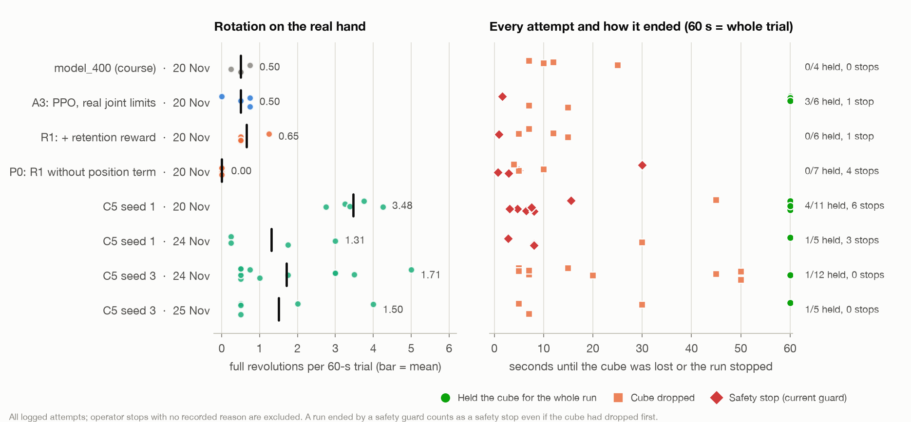
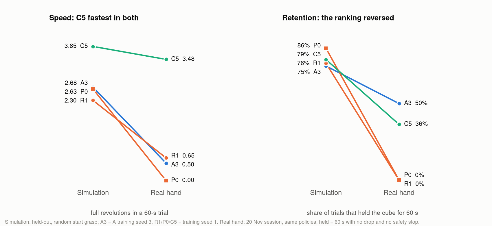
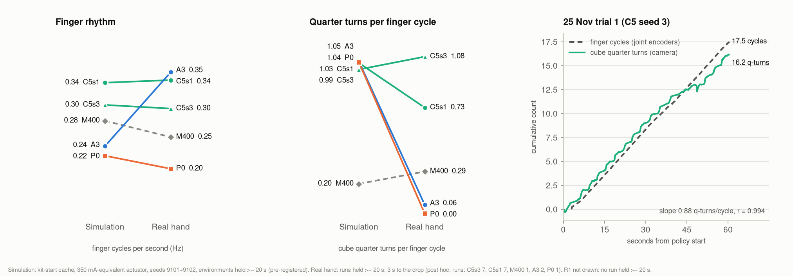
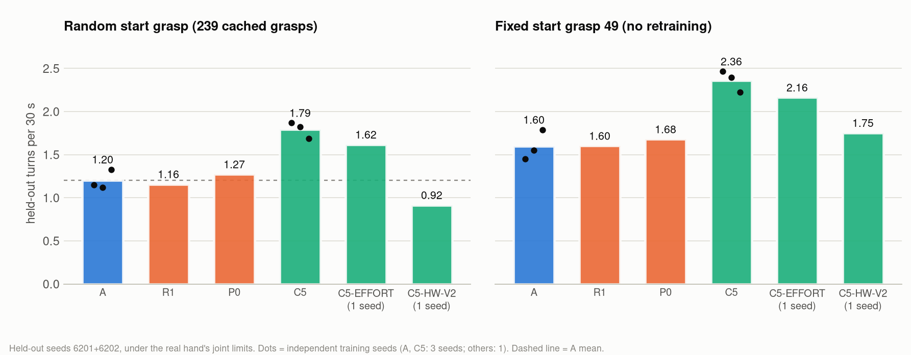
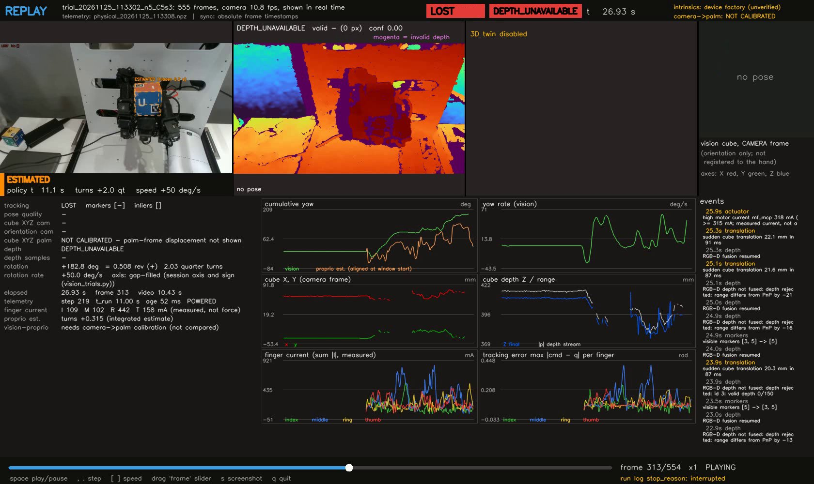

# Sensorless in-hand cube rotation on the LEAP Hand: from simulation to the real hand

A right LEAP Hand spins a 58 mm cube about the vertical axis using **only its own joint readings**: no camera, no tactile sensors, no cube pose in the policy. The project started from the course's continuous-yaw package (`model_400`). It then fixed the training environment, ran seven simulation studies with more than 20 from-scratch PPO runs (the last five pre-registered), and took the resulting policies to the physical hand in five supervised sessions, with every attempt logged. The full write-up is the [project report](docs/report/REPORT.md).

**Headline.** The best policy, **C5**, made **3.48 full revolutions per 60-s trial on the real hand, against 0.50 for the course baseline `model_400`** (20 Nov, operator counts). In simulation it beats the proprioceptive PPO baseline by **+0.59 turns per 30 s [95% CI +0.35, +0.83], p = 0.0025, over three training seeds each**. The work also shows *why* the rest of the gap to simulation exists: it measures each sim-to-real mismatch and traces the hand's safety stops to a single finger.

<picture>
  <source media="(prefers-color-scheme: dark)" srcset="docs/figures/readme/real_hand_attempts_dark.png">
  
</picture>

*Every logged real-hand attempt in the three comparison sessions. Left: rotation per trial. Right: how long each attempt kept the cube and how it ended. C5 seed 1 rotates fastest but trips a safety guard often. C5 seed 3 never tripped one (0 of 13 on 24 Nov). Its drops in the first 5–7 s come from where the cube was placed at the start (see [24 Nov](docs/hardware_session_2026-11-24.md)).*

---

## Results at a glance

| | Baseline | This project | Evidence |
|---|---|---|---|
| Real hand: full revolutions per 60-s trial (20 Nov) | `model_400` 0.50 (n = 4), A3 0.50 (n = 4) | **C5 3.48** (n = 5) | [session report](docs/hardware_session_2026-11-20.md), [audit](docs/hardware_policy_actuator_audit_2026-11-20.md) |
| Real hand: safety stops, C5 seed 1 vs seed 3 | seed 1: 9 of 16 attempts | **seed 3: 0 of 13** (Fisher p = 0.001) | [24 Nov](docs/hardware_session_2026-11-24.md) |
| Simulation: held-out turns per 30 s, real joint limits | A 1.20 (3 seeds) | **C5 1.79** (3 seeds) | [C5 seeds](training_source/project/experiments/grasp_rotation_v2/results/c5_seeds.md) |
| Simulation: same, starting from grasp 49 | A 1.60 | **C5 2.36** | [GRV2](training_source/project/experiments/grasp_rotation_v2/README.md) |
| Simulation: failure rate, random start grasp vs grasp 49 (no retraining) | 23.6% | **0.7%** | [GRV2 Phase 1](training_source/project/experiments/grasp_rotation_v2/README.md#phase-1-grasp-initialisation-no-ppo-training) |
| Simulation: index-finger jam rate at the hand's 350 mA limit | C5 14.6% | **C5-EFFORT 0.5%** at 0.91 × C5 speed (1 seed) | [report](training_source/project/experiments/c5_hw_v1/REPORT_EFFORT_V1.md) |
| Real hand vs simulation: quarter turns per finger cycle (speed while held = finger rhythm × turns per cycle) | A3 1.05 → 0.06 | **C5 seed 3 0.99 → 1.08**, rhythm 0.30 → 0.30 Hz (exploratory, small n) | [gait efficiency](training_source/project/experiments/gait_efficiency/README.md) |
| Simulation: training from simulated kit starts (C5-HW-V2), 350 mA-equivalent actuator | C5: kit-start failure 4.6%; 1.784 turns per 30 s from random grasps | **Failed, 1 seed:** kit-start failure 4.5% (no gain); 0.956 turns from random grasps; pre-registered verdict FAIL | [report](training_source/project/experiments/c5_hw_v2/REPORT.md) |
| Cube state from joint readings alone (held-out policy) | linear model: 15.2 mm, 39° | **MLP: 10.2 mm, 16.8°** | [state estimation](training_source/project/experiments/scratch_state_estimation/README.md#31-estimator-b-held-out-policy-test-split-stage-2) |
| Fingertip contact force from joint readings alone (unseen policies) | linear model: 0.30 N | **0.19 N mean error, R² 0.78** | [force estimation](training_source/project/experiments/force_estimation/README.md) |

Simulation numbers are on held-out evaluation seeds that were used once. From the 17 Nov study on, each protocol and its pass/fail thresholds were written and hashed before training.

---

## What transferred to the real hand, and what did not

<picture>
  <source media="(prefers-color-scheme: dark)" srcset="docs/figures/readme/sim_vs_real_dark.png">
  
</picture>

- **C5's speed transferred.** The policy that rotated fastest in simulation is also the fastest on the hand; the others lost most of their speed. Its real rotation rate while holding the cube (about 3.6–4.4 rev/min) is the same order as in simulation (3.7 rev/min).
- **Retention did not.** The two policies trained with a retention reward (R1, P0) had the lowest 30-s failure rates in simulation and dropped it in every real trial, after about 10 s. The likely cause is the start: the hand closes to its own default pose, not to a training grasp (see the gap table below).
- **Where the speed went: turns per finger cycle, not finger rhythm.** Speed while held = finger rhythm × quarter turns per finger cycle, and the joint encoders give the cycles. The policies that lost speed on the hand kept their finger rhythm (both C5 seeds within 2% of simulation) but turned the cube less per cycle: C5 seed 1 0.73 against 1.03 in simulation, A3 0.06 against 1.05. C5 seed 3 kept both factors. This is exploratory with small n, and the cycle count is camera-checked only for C5 seed 3 ([gait efficiency](training_source/project/experiments/gait_efficiency/README.md)).

<picture>
  <source media="(prefers-color-scheme: dark)" srcset="training_source/project/experiments/gait_efficiency/figures/gait_efficiency_dark.png">
  
</picture>

- **The estimator's cube rotation was not grounded on the hand.** Its integrated yaw was anti-correlated with what the operator saw (Spearman −0.42). That is why camera tracking was built (below).

## How C5 was found (simulation)

<picture>
  <source media="(prefers-color-scheme: dark)" srcset="docs/figures/readme/sim_progress_dark.png">
  
</picture>

Two separate improvements, each isolated by a pre-registered test:

1. **The start grasp matters more than the policy.** Grasp quality turned out to be a property of the grasp, not of the policy (split-half reliability 0.99). Starting every episode from one robust grasp (cache index 49) raises the turns of every existing policy by 31–37% and cuts failure from about 24% to about 1%, with no retraining. The gain survives ±2 mm / ±10° placement noise.
2. **The reward was capping the speed.** The retention penalty's position term taxed the drift that fast rotation causes, and the ±0.25 rad/s clip on the yaw reward gave nothing for going faster. Raising the clip to ±0.5 rad/s (C5) gives +56% turns over A, with the same failure rate as R1. All three training seeds pass all five pre-registered thresholds.

Together, C5 from grasp 49 reaches 2.36 turns per 30 s, about twice the baseline's 1.20 from random starts.

---

## Sim-to-real gaps found and measured

| Gap | Training (simulation) | Real hand | Measured effect | How it was found | Status |
|---|---|---|---|---|---|
| Sideways (rot) joint limits | ±1.05 rad | ±0.52 rad | C loses 0.59 turns, A 0.14 (closed-loop rehearsal) | [17 Nov session](docs/hardware_session_2026-11-17.md) | **Fixed:** every later policy trains under the real limits ([hwlimit_ac](training_source/project/experiments/hwlimit_ac/README.md)) |
| Motor current limit | 550 mA | 350 mA | C5's index MCP/PIP jams at the limit; 6 of 11 attempts ended by a safety guard (5 by the current guard) | [actuator audit](docs/hardware_policy_actuator_audit_2026-11-20.md) | **Addressed in simulation:** C5-EFFORT cuts the jam rate 96.5% (not yet run on the hand) |
| Actuator response lag | ~280 ms | ~80 ms | The real hand tracks about 3.5× more tightly | same audit, one lag estimator on both | Open: the pre-registered refit **failed**; no delay/damping/friction setting came within 150 ms of the hand (best 218 ms vs 79 ms), so the actuator model itself needs changing ([C5-HW-V2 §3](training_source/project/experiments/c5_hw_v2/REPORT.md#3-step-a-response-fit-failed)) |
| Start grasp | settled grasps from a 239-grasp cache | the hand's default closing pose, cube placed by hand | C5 seed 3: 6 of 12 trials drop at 5–7 s; long holds otherwise | [24 Nov session](docs/hardware_session_2026-11-24.md) | Open: training only from simulated kit starts did not help ([C5-HW-V2](training_source/project/experiments/c5_hw_v2/REPORT.md), 1 seed); placement jig or grasp-49 start pose (needs supervisor approval) |
| PIP upper limit | 1.825 rad | 1.885 rad | −0.17 ± 0.12 turns for C5 seed 3 in rehearsal | deploy verification | Documented, unchanged |
| Cube marker layout (vision) | `layout.json` | U/A faces swapped, two markers rotated 180°, markers off-centre | tracker flicker | [layout check](docs/live_vision_digital_twin.md#2-marker-layout-what-the-files-say-and-what-the-real-cube-shows) | **Fixed:** measured layout |

---

## Research log

| Date | Study | Question | Outcome |
|---|---|---|---|
| 11 Nov | [Course package](docs/course_package.md) | Run `model_400` faithfully | Portable scene fixed (the hand sat 10 cm too low); full MJLab playback on macOS |
| 12–13 Nov | [State estimation A/B/C/D](training_source/project/experiments/scratch_state_estimation/README.md) | Does cube state estimated from joint readings help PPO? | **Fixed 4 bugs in the course environment** (stale reset anchor; Euler tilt singular near 90° pitch, terminating 98–100% of tilted starts; Euler-yaw rotation measure; 95% of `model_400`'s actions saturated). Oracle state +0.263 turns [+0.148, +0.376]; estimated state +0.150 [−0.006, +0.339], 57% of the oracle gain, and faster learning in every seed |
| 13 Nov | [Fingertip force estimation](training_source/project/experiments/force_estimation/README.md) | Can contact force be estimated without a sensor? | 0.19 N mean error, R² 0.78 on unseen policies; contact AUROC 0.94–0.98 |
| 17 Nov | [Hardware session 1](docs/hardware_session_2026-11-17.md) | Do the study policies run on the hand? | Guarded function test passes; the hand's sideways joint limits are half the training range |
| 17–18 Nov | [A vs C under real limits](training_source/project/experiments/hwlimit_ac/README.md) | Does the estimated state still help? | **No:** C − A = −0.041 [−0.150, +0.055]; the estimator's errors are 1.36–1.53× larger on the new gaits |
| 18 Nov | [Hardware session 2](docs/hardware_session_2026-11-18.md) | Live cube and force monitor on the hand | Thumb force estimate tracks motor current; loop jitter traced to the USB latency timer (fixed by 20 Nov: 20% → 5% of steps late) |
| 19–20 Nov | [Retention-V1](training_source/project/experiments/retention_v1/README.md) | Does a retention reward reduce drops? | In simulation, pose failures −23 to −30%, but turns not improved (1.16 vs 1.21) |
| 20 Nov | [Grasp-Rotation-V2](training_source/project/experiments/grasp_rotation_v2/README.md) | Start grasp vs reward balance | Grasp 49: failure 24% → 0.7%; C5: +56% turns |
| 20 Nov | [Hardware session 3](docs/hardware_session_2026-11-20.md) | A3 vs C5 vs R1 vs P0 (+ `model_400`), 37 logged attempts | C5 7× faster; R1 and P0 drop every time; C5 trips a safety guard in 6 of 11 attempts (5 of them the current guard) |
| 21–24 Nov | [C5 three seeds](training_source/project/experiments/grasp_rotation_v2/results/c5_seeds.md) | Is C5 reproducible? | +0.59 turns [+0.35, +0.83], p = 0.0025; every seed passes every threshold |
| 24 Nov | [Actuator audit](docs/hardware_policy_actuator_audit_2026-11-20.md) | Why does C5 trip the guard? | Index-finger jams at 350 mA, a limit training never saw (550 mA); real lag 80 ms vs ~280 ms in simulation |
| 24 Nov | [Hardware session 4](docs/hardware_session_2026-11-24.md) | C5 seed 1 vs seed 3 | Seed 3 (chosen beforehand by a 350 mA simulation screen): 0 of 13 safety stops vs 9 of 16; retention set by placement |
| 24 Nov | [C5-HW-EFFORT-V1](training_source/project/experiments/c5_hw_v1/REPORT_EFFORT_V1.md) | Train the jam out | Jam rate 14.6% → 0.5% at 0.91 × C5 speed (single seed, simulation only) |
| 24–25 Nov | [Cube vision](docs/live_vision_digital_twin.md), [hardware session 5](docs/hardware_session_2026-11-25.md) | Measure the cube on the real hand | Multi-face ArUco + RealSense tracking, recorded per trial; turns while hidden estimated from both sides of each gap; turn counts match the operator within 1 quarter turn in 2 of 3 trials |
| 26 Nov | [C5-HW-V2](training_source/project/experiments/c5_hw_v2/REPORT.md) | Train under the hand's conditions (350 mA, actuator response, kit start) | Actuator refit **failed** its pre-registered rule; training only from simulated kit starts **failed** all three pre-registered criteria (1 seed, simulation only): no kit-start gain, 0.536 × C5's turns from random grasps |
| 26 Nov | [Final protocol (draft)](docs/hardware_protocol_final_DRAFT.md), [report](docs/report/REPORT.md) | Plan the final real-hand comparison; write up | Protocol is a DRAFT, not approved; report with every number traced to a file ([NUMBERS.md](docs/report/NUMBERS.md)) |
| 27 Nov | [Gait efficiency](training_source/project/experiments/gait_efficiency/README.md) | Where did the speed go on the real hand? | Finger rhythm transferred (both C5 seeds within 2%); quarter turns per finger cycle did not (C5 seed 1 0.703×, A3 0.058× of simulation), except for C5 seed 3. Simulation half pre-registered, hardware half post hoc |



*Per-trial camera video (25 Nov, C5 seed 3). When the fingers hide every marker, the cube is drawn as an estimate (orange dashed box) and labelled as one, rather than shown as a measurement.*

---

## Negative results and limitations

These are reported with the same weight as the positive results:

- **The retention reward did not transfer.** R1 and P0 had the lowest 30-s failure rates in simulation and held the cube worst on the hand.
- **Estimated cube state stopped helping under the real joint limits.** The early A/B/C/D advantage (with the course's wider limits and a shorter budget) did not survive retraining under the hand's limits.
- **The proprioceptive cube-rotation estimate is not valid on the hand** (Spearman −0.42 against the operator's counts).
- **The hardware samples are small.** There are 4–12 valid attempts per policy and session, counted by eye by one operator. The camera pipeline now exists to replace the counts, but has been used in only one session.
- **Cube placement is not controlled.** It decides retention more than the policy does, and the logs cannot detect it (the start pose is identical to within 0.008 rad in early-drop and long-hold trials).
- **C5-HW-V2 failed** (1 seed, simulation). Trained only from simulated kit starts, it did not reduce kit-start failures (4.5% vs C5's 4.6%) and from random grasps rotated at 0.536 × C5's speed; its actuator refit also failed. A post-hoc check found its first criterion was set below a failure floor shared by every policy.
- **Single seeds:** R1, P0, C5-EFFORT and C5-HW-V2 were trained once. C5 is the only new recipe confirmed over three seeds.
- **Counting unit:** operator counts are quarter turns (90°). The 20 Nov session report was written before this was confirmed. The [audit](docs/hardware_policy_actuator_audit_2026-11-20.md#3-quarter-turns-and-full-revolutions) gives the corrected full revolutions used here.

## How the work was run

- **Pre-registration.** From the A vs C study on (17 Nov), each study's protocol, thresholds and evaluation seeds were written before training and hashed (`PROTOCOL*.md` + `logs/*.sha256`). Held-out seeds were used once.
- **Preservation checks.** From the force study on, every new study runs in its own folder and verifies that earlier code, checkpoints and datasets are byte-identical (`scripts/check_preservation.sh` in each experiment).
- **Bugs kept visible.** A bug in this project's own code (the frozen estimator's head was zeroed in the first C runs) was found by an ablation. The invalid runs are kept under `results/_INVALID_*` and a regression test guards the fix.
- **Hardware safety.** The guards (350 mA limit, 450 mA abort, 60 °C, tracking and velocity aborts) were never weakened. Each policy needed a torque-off shadow pass before a powered run. Every attempt is logged, including safety stops and discarded runs, and safety stops count as failures.
- **Deploy parity.** Each policy is checked numerically between the deploy kit and the training actor (max difference ≤ 3e-5) and rehearsed in closed loop in simulation before it touches the hand.

---

## Repository map

```text
README.md                          this overview
docs/                              hardware session reports, actuator audit, vision guide, course lesson
  report/                          project report (REPORT.md), number sources (NUMBERS.md), PDF build
  hardware_protocol_final_DRAFT.md final real-hand protocol, DRAFT / NOT APPROVED
  figures/readme/                  the figures above (light + dark), headline_numbers.json
  course_package.md                the original course README (quick start for model_400)
training_source/project/
  src/in_hand_rotation_mjlab/      MJLab tasks, rewards, estimators, study code
  experiments/
    scratch_state_estimation/      A/B/C/D study (12–13 Nov)
    force_estimation/              sensorless fingertip force (13 Nov)
    hwlimit_ac/                    A vs C under the real joint limits (17–18 Nov)
    retention_v1/                  retention reward, R1 (19–20 Nov)
    grasp_rotation_v2/             grasp initialisation + C5, P0 (20–24 Nov)
    c5_hw_v1/                      actuator audit follow-up, C5-EFFORT (24 Nov)
    c5_hw_v2/                      actuator refit, kit-start training, C5-HW-V2 (26 Nov)
    gait_efficiency/               finger rhythm vs turns per finger cycle, sim vs real hand (27 Nov)
  real_world/cube_vision/          ArUco + RealSense cube tracker, gap filling, dashboard
LEAP_Hand_RL_Deploy_Kit/           guarded hardware runtime, trial scheduler, monitors, logs, audit
checkpoint/  policy/  simulation/  course model_400 package (viewer, policy, replay)
hardware/  config/                 course hardware bridge and gain profiles
scripts/                           launchers; make_readme_figures.py; make_hero_gif.sh
evidence/  reference/              course-provided recordings and the model_400 reference trajectory
```

## Reproduce

**The figures and headline numbers in this README** are regenerated from the committed result files:

```bash
uv run --no-project --with matplotlib --with numpy python scripts/make_readme_figures.py
```

**Each study** has a *Reproduction* section in its README with the exact training and evaluation commands. Training needs Linux with an NVIDIA GPU. The studies ran on a Slurm GPU cluster with 4096 parallel environments per run.

**The course baseline in simulation** (works on macOS; prerequisite: [`uv`](https://docs.astral.sh/uv/)):

```bash
scripts/setup.sh                                   # uv sync + self-tests
scripts/replay.sh --start-time 5                   # exact model_400 trajectory in MuJoCo
scripts/setup_training.sh && scripts/play_mjlab.sh # model_400 live in the full MJLab task
```

More options are in [docs/course_package.md](docs/course_package.md).

**The real hand** (supervised only): see the [deploy kit README](LEAP_Hand_RL_Deploy_Kit/README.md) and [TA_GUIDE.md](TA_GUIDE.md). Always do a torque-off shadow pass first. Keep the power cutoff within reach. Never weaken a current or temperature limit.

## Starting point and credits

The starting point is the course's Class 06 continuous-yaw package: the `model_400` checkpoint, the MJLab task and training source, the portable viewer and the guarded hardware bridge. Its README is kept unchanged in [docs/course_package.md](docs/course_package.md). The deploy kit (`LEAP_Hand_RL_Deploy_Kit/`) is the course's, extended here with the trial, monitoring and audit tools. LEAP Hand assets are under the MIT licence in [LICENSES/](LICENSES/). The 58 mm cube with ArUco markers is the MBZUAI cube.
