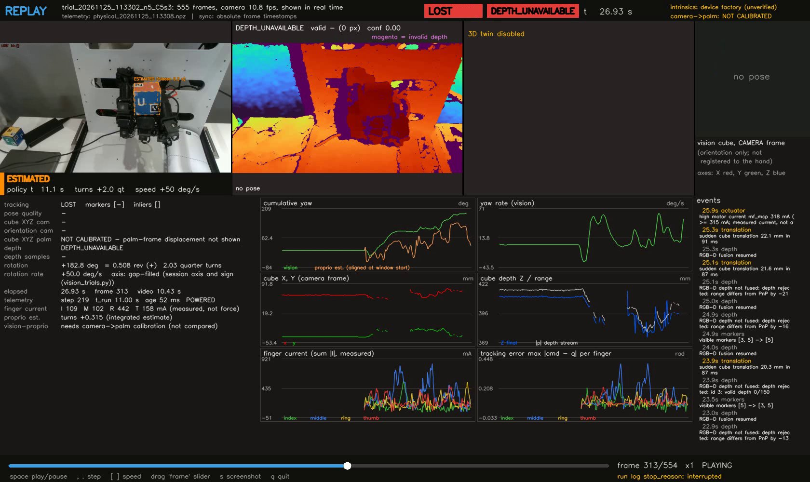
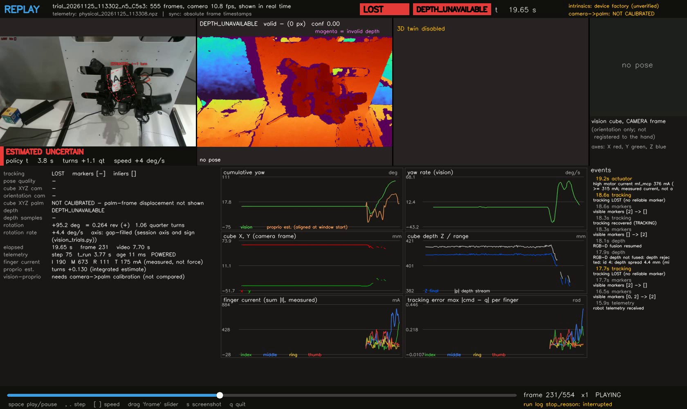

# LEAP Hand hardware session, 25 Nov 2026: camera and policy runs together

**Goal:** check that the Intel RealSense camera pipeline (`cube_vision`) runs alongside the hand and records every trial. Also check that the trial video shows the cube's state, including while the fingers hide it. Policy comparison was **not** the goal: all runs used C5 seed 3 (`C5s3`).

**Result:**
- **Camera and hand run together.** `./leap.sh trial C5s3` with `LEAP_USE_VISION=1` now does the whole cycle:
  - opens the camera panel and records the trial;
  - routes the hand's telemetry through the panel to the kit viewer;
  - stops the camera when the run ends;
  - prints the camera's turn count and renders a trial video.
- **Turn counts.** The camera's gap-aware count matches the operator's within 1 quarter turn in trials 1 and 5. Trial 4 differs (0.8 vs 2) and is not explained.
- **About 40% of the policy time** the cube is hidden by the fingers or shows no readable marker. The video shows an **estimate** for those frames, labelled as such, instead of no pose.

## Runs

| trial | policy | run | operator: quarter turns / drop | camera video |
|---|---|---|---|---|
| 1 | C5s3 | 60 s, completed | 16, no drop | yes (from the `./leap.sh vision` panel) |
| 2 | C5s3 | 7 s | 2, dropped at 7 s | **no** (camera panel was closed) |
| 3 | C5s3 | 14 s | 2, dropped at 5 s ("initial pose problem") | **no** |
| 4 | C5s3 | 9 s | 2, dropped at 5 s ("placement") | yes (automatic per-trial recording) |
| 5 | C5s3 | 36 s | 8, dropped at 30 s ("placement") | yes (automatic per-trial recording) |

- Log: `LEAP_Hand_RL_Deploy_Kit/logs/trials_20261125.csv`; camera results: `trials_20261125_vision.csv`.
- One earlier run (`physical_20261125_110116.npz`, 11 s) was interrupted and not recorded as a trial.
- Drops again came from the start placement (as on 24 Nov). This session was not a test of the policy.

## Camera results (policy window)

| trial | measured | 1-face resolved | estimated (hidden) | uncertain | camera quarter turns [range] | operator |
|---|---|---|---|---|---|---|
| 1 | 58% | 2% | 40% | 0% | 16.2 [8.2, 24.2] | 16 |
| 4 | 72% | 2% | 26% | 0% | 0.8 | 2 |
| 5 | 61% | 1% | 31% | 8% | 7.0 [3.0, 11.0] | 8 |

The range is wide when a hidden stretch is long enough that the number of turns made while hidden could be off by one full turn. Those stretches are listed in the CSV under "check video at".

## Problems found and fixed

1. **Flicker at the start of the day: wrong cube layout.** The physical cube does not match `layout.json`. With the measured layout (all six faces confirmed) the tracker went from constant conflicts to 100% tracking on a static cube. Details: `docs/realsense_setup_2026-11-25.md` §3b, §3d.
2. **Second cube in view.** A second MBZUAI cube with the same marker IDs was on the table. The tracker sometimes followed it (0.85 m away instead of 0.41 m) and produced a few impossible poses, which crashed the old video render.
   - Markers are now searched only in the hand region (`--roi`), and poses outside 0.05–0.7 m are dropped (`--max-range-m`).
   - Keep only one cube in view.
3. **Low frame rate.** Live recording ran at only about 11 fps, because the panel was redrawn in series with tracking and recording. The video file was also tagged 30 fps, so replays played 2.7× too fast.
   - The panel now redraws at 10 Hz and recording runs in a background thread. The loop handles about 94 fps offline.
   - **Not yet confirmed on the camera:** the RealSense was unplugged when this was tested.
4. **Hidden frames** (fingers over the cube, or unreadable markers). These are now estimated; see below.

## How hidden frames are estimated

The method is in `cube_vision/gapfill.py` and `cube_vision/fill.py`. It runs after the trial, using the frames before and after each gap:

- **Turns while hidden:** the cube's rotation speed on both sides of a gap decides how many turns happened while it was hidden. The predictability is learned from the trial's own visible motion. If the wrong number of turns has more than a 1% chance, the gap is flagged as uncertain and the range widened by ±1 turn.
- **Single-face frames:** when only one face is visible, its two possible orientations are resolved by whichever matches the motion on both sides.
- **Every other hidden frame:** the orientation is interpolated smoothly (matching the speed at both ends) and the position linearly.

In the video (`scripts/trial_video.py`):
- a measured cube is drawn as before;
- an estimated cube is an **orange dashed box**;
- an uncertain one is **red, "±1 turn"**;
- a status bar shows the state, the turns since the policy started, and the speed.

The video plays in real time, from 5 s before the policy starts (so the placement is visible) to 3 s after the run.

*Trial 5 at 11.1 s: the fingers hide the markers (tracker LOST). The orange dashed cube is the estimate: 2.0 quarter turns, 50°/s.*

*Trial 5 at 3.8 s: hidden for 2.5 s. The number of turns while hidden is uncertain (±1 turn), so it is drawn in red.*

**Validation:**
- **Synthetic spins** with known truth (200 sequences): no case was wrong without being flagged.
- **Real recording with artificially hidden 0.5–3 s windows:** 0% wrong turns.
- **Unit tests:** `tests/test_vision_trials.py` (4 tests). These include a spin hidden for 1.2 s: the estimate stays within 10° of the truth and the single-face flip resolves to the truth.

## Files

- **Videos** (not in git, 13–75 MB each), in `outputs/cube_vision/`:
  - trial 1: `live_20261125_111603/dashboard_estimated.mp4`
  - trial 4: `trial_20261125_113142_n4_C5s3/dashboard_estimated.mp4`
  - trial 5: `trial_20261125_113302_n5_C5s3/dashboard_estimated.mp4`
- **Per-trial turn and speed series and plots:** `LEAP_Hand_RL_Deploy_Kit/logs/trials_20261125_trial{1,4,5}_vision.{csv,png}`.
- **Setup and method details:** `docs/realsense_setup_2026-11-25.md`.
- **Settings:** `LEAP_Hand_RL_Deploy_Kit/configs/hand.env` (`LEAP_VISION_*`). If the camera is moved, re-measure `--roi`.

## Next session

1. Plug in the camera and run `./leap.sh trial C5s3`. The printout should show about 30 fps. More frames mean shorter gaps and fewer uncertain stretches.
2. Remove the second cube; improve the start placement before comparing policies again.
3. Optional: more light on the hand, to reduce motion blur.
4. Calibrate the camera-to-palm transform, so that vision can be compared with the kit's cube estimate in the palm frame. The two currently disagree in sign in the dashboard plot. This is not resolved; it needs the calibration.
