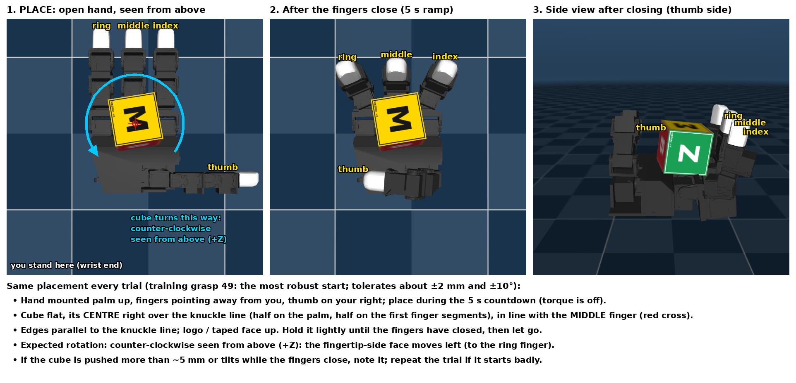

# Real-hand trials: A3, C5, R1, P0

**Goal:** test, on the real LEAP hand, four comparisons made in simulation. Each trial is a 60 s powered run, observed by the operator. The live monitor (estimated cube and fingertip forces) runs for every policy as a display only.

## Policies

| Name | What it is | Kit folder | Simulation reference (30 s, held-out) |
|---|---|---|---|
| A3 | Baseline A, seed 3, trained inside the kit joint limits | `policies/A3` → `hwlimit_ac/deploy/policies/A_seed3` | 1.33 turns, 24% failure |
| R1 | A + retention reward | `policies/R1` → `retention_v1/deploy/policies/R_seed1` | 1.16 turns, 19% failure |
| P0 | R1 without the position part of the retention penalty | `policies/P0` → `grasp_rotation_v2/deploy/policies/P0_seed1` | 1.27 turns, **11.5%** failure |
| C5 | R1 with the yaw-reward clip at ±0.5 rad/s | `policies/C5` → `grasp_rotation_v2/deploy/policies/C5_seed1` | **1.87** turns, 20% failure |

- **None of the four reads the cube estimator.** "C5" is a reward-study candidate, not condition C. All use the same 320 proprioceptive inputs, the tanh action and the kit limits.
- **Simulated "failure"** includes the tilt/drift termination rule, not only real drops. Simulation shows real drops within 60 s at 1–7%, so on the hand expect few drops. Time held and visible slips matter as well.
- **C5 moves its fingers about 18% faster** (grasp_rotation_v2 README, "movement cost"). This is a sim-to-real risk; watch for it.

## Questions (fixed before the runs)

| | Comparison | Question | Measure |
|---|---|---|---|
| Q1 | A3 vs C5 | Which rotates faster? | observed turns per minute while held |
| Q2 | R1 vs P0 | Which keeps the cube more reliably? | drops; time held |
| Q3 | A3 vs R1 | Did the retention reward improve real-world stability? | drops; time held |
| Q4 | C5 vs P0 | Speed vs retention trade-off | all three |

## Design

- **Schedule:** 5 blocks × 4 policies = 20 trials of 60 s, about 40 minutes of hand time. Within each block the order follows a balanced Latin square (A3 C5 R1 P0 / C5 P0 A3 R1 / R1 A3 P0 C5 / P0 R1 C5 A3 / …), so warm-up, motor heating and the operator's practice do not favour any policy. `./leap.sh trial next` always runs the next scheduled policy.
- **Same everything else:** start pose (the kit's default grasp), gains H1, current limit 350 mA, abort at 450 mA, 60 °C, run length.
- **One trial** = 5 s cube placement, 5 s ramp to the grasp, 60 s policy, then return home.

## Before you start

```bash
cd ~/Documents/AnyDesk/Dexterous-In-Hand-Manipulation/LEAP_Hand_RL_Deploy_Kit
sudo chmod 666 /dev/ttyUSB0                                              # port access
echo 1 | sudo tee /sys/bus/usb-serial/devices/ttyUSB0/latency_timer      # 1 ms; avoids loop jitter (18 Nov problem)
./leap.sh check                                                          # all 16 motors, torque off
./leap.sh trial-setup                                                    # shadow run for each of the 4 policies (4 x 30 s)
```

## Each trial

```bash
./leap.sh trial next        # shows which policy; type YES; place the cube during the countdown
```

After the run, the terminal asks:
1. **Turns you saw**, in the usual direction (negative if backwards). Count quarter turns with a marked face (put tape on one face). Leave it blank if you could not tell.
2. **Did the cube drop or leave the grasp?** If yes, **about when** (seconds after the policy started).
3. **Did anyone touch or help the cube?** Such trials are excluded from the comparison.
4. **Notes:** slips, tilt, stuck fingers, unusual noise.

Answers are saved to `logs/trials.csv` with the run's log file, policy checksum, estimated turns, peak current and temperature, and loop jitter. If jitter exceeds 10%, the recorder warns you; repeat that trial with `./leap.sh trial <NAME>`.

**Cube placement:** identical every trial, as in the figure below. It is the training's most robust start (grasp 49 of the 239-grasp cache), which in simulation keeps its advantage under about ±2 mm and ±10° placement error.
- Place the cube flat, with its centre right over the knuckle line (half on the palm, half on the first finger segments), in line with the middle finger.
- Keep its edges parallel to the knuckle line and the marked face up.
- Hold it lightly until the fingers have closed.



The figure is regenerated by `LEAP_Hand_RL_Deploy_Kit/kit/placement_figure.py`. The kit still closes the fingers to its own default grasp pose, not grasp 49's finger angles. In simulation that pose presses the cube by 1–2 mm, which is normal grasp contact.

**Drop:** the cube falls out or is lying loose, out of the fingers' reach. A cube that tilts but stays in the hand is not a drop; write it in the notes.

## After the trials

```bash
./leap.sh trial-plan        # progress
./leap.sh compare           # Q1-Q4 tables -> logs/trial_comparison.md / .json
./leap.sh view              # replay any run in 3D
./leap.sh analyze logs/physical_X.npz   # estimated forces vs motor current for one run
```

With 5 trials per policy, the permutation p-values and bootstrap CIs are indicative only. Report the per-trial values next to them. Stop if a guard trips repeatedly, a motor goes above 55 °C, or a finger jams.

## Deployment checks done (simulation and offline, no hardware)

- **Kit runtime = training actor:** ≤ 1.5e-5 for P0 and C5 (`grasp_rotation_v2/results/deploy_verification.json`); R1 and A3 were verified in their own studies. Checkpoint sha256 values match each study's MANIFEST.
- **Closed-loop rehearsal through the kit** (`grasp_rotation_v2/results/deploy_rehearsal.json`; R1 in `retention_v1/results/`; A3 in `hwlimit_ac/results/`); see the table below.
- **Known gap for all policies:** the kit allows PIP up to 1.885 rad, training 1.825 (`hwlimit_ac/README.md` §8.5).

**Rehearsal through the kit runtime.** Simulation, closed loop, 128 environments × 30 s, seed 5001. "Kit" means reset to the measured pose and kit limits, as on the hand. Failure includes the tilt/drift rule; there were no real drops in any condition.

| Policy | Training actor: turns / failure | Kit: turns (Δ ± 95% CI) / failure |
|---|---|---|
| A3 | 1.37 / 22.7% | 1.30 (−0.06) / 23.4% |
| R1 | 1.20 / 12.5% | 1.16 (−0.04) / 19.5% |
| P0 | 1.29 / 10.9% | 1.26 (−0.03 ± 0.07) / 14.8% |
| C5 | 1.84 / 21.1% | 1.80 (−0.03 ± 0.11) / 21.9% |

**Expected ordering on the hand, if the simulation transfers:**
- **Speed:** C5 ≫ A3 ≈ P0 > R1.
- **Retention:** P0 best, then R1 ≈ C5 ≈ A3.

**Caveat on retention:** the kit's measured-pose reset raises the simulated failure of R1 (+7 points) and P0 (+4 points). Their retention advantage is therefore smaller under kit semantics than in the training environment.
