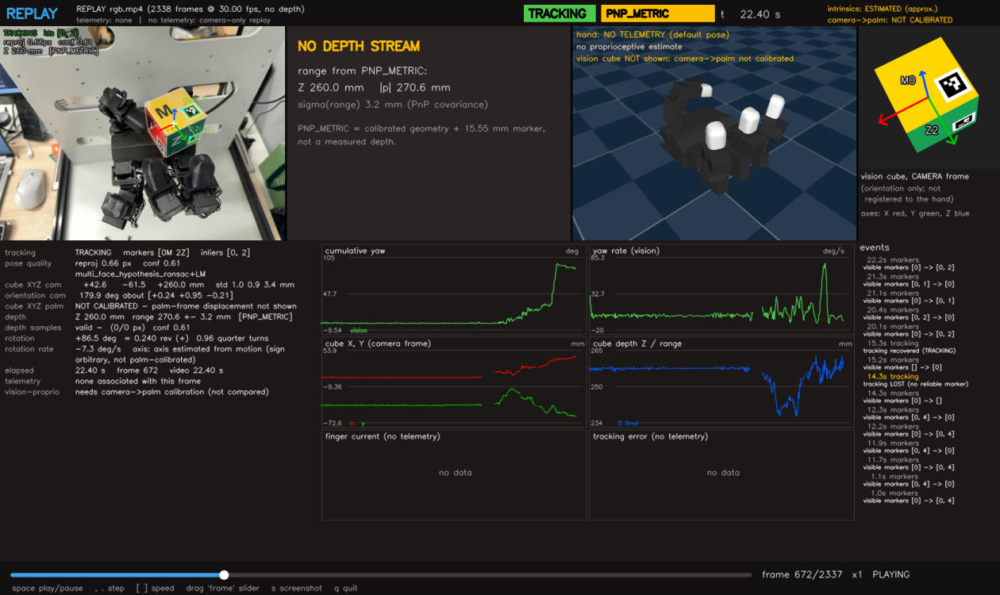
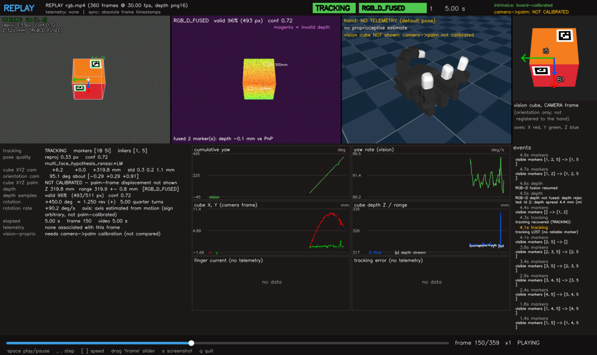

# Live vision, depth and digital-twin dashboard for the MBZUAI cube

This is a **read-only** monitoring instrument for the right LEAP Hand cube-rotation experiments. It:
- tracks the six-marker MBZUAI cube with a camera;
- estimates its metric pose and depth (RGB-D when a depth camera is present, otherwise from PnP);
- integrates the cube's continuous rotation;
- combines this with the hand's existing telemetry in a live or replayed dashboard.





> **Read-only guarantee.** The package never imports the Dynamixel SDK, a serial library or the kit's RPC, never sends motor commands, and never starts or stops a run. Its only network send is an optional relay of received telemetry datagrams to a *different* local viewer port. A test checks this statically (`tests/test_cube_vision.py::test_package_is_read_only`). Hardware limits, guards, gains and policies are untouched.

## 1. Status at a glance (2026-11-24)

| Item | State |
|---|---|
| Cube geometry | Loaded from `training_source/project/assets/mbzuai_cube/layout.json`: 58 mm cube, half side 29 mm, 15.55 mm markers, `DICT_4X4_50`, IDs 0–5 = +Z M, +X B, +Y Z, −X U, −Y A, −Z I. Face normals equal marker_x × marker_y for all six faces. |
| Marker position in the face | **Not centred.** See §2. Stored in `marker_print_layout.json` (preview-derived, unverified). |
| Physical cube vs `layout.json` | **Mismatch found** in `evidence/videos/rgb.mp4`. See §2. A candidate measured layout exists; it is used only when selected explicitly. |
| Camera on the development machine | None (no `/dev/video*`, no RealSense). Live mode was exercised end to end with a file-backed stream source and simulated kit UDP packets (`test_live_loop_with_stream_source_and_udp_telemetry`), but **not with a physical camera**. |
| Native depth | Supported (`pyrealsense2` 2.59, colour-aligned depth). **No RealSense was available**, so it was tested with synthetic RGB-D only. |
| Recordings found | `evidence/videos/rgb.mp4` (real cube, 640×480, 30 fps, 78 s, **no depth, no frame timestamps, no matching robot log**). Two simulation renders and one side-by-side demo video. 119 kit run logs, none time-linked to a video. Run `scripts/cube_vision.py inventory`. |
| Intrinsics | None calibrated for a real camera. `rgb.mp4` has **approximate** intrinsics estimated from the cube markers themselves (status `estimated_from_cube_markers`). |
| Camera-to-palm | **Not calibrated.** `camera_to_palm_iphone.json` is an identity placeholder (`calibrated: false`) and is reported, never used. |
| iPhone / ARKit | No ARKit producer exists in the repo. `monitor_pose_decomposition.py` only *consumes* a tracker JSONL. A phone streaming MJPEG/RTSP can be used as an OpenCV URL source (RGB only, so `PNP_METRIC`). |

## 2. Marker layout: what the files say and what the real cube shows

### 2.1 In-face position

`layout.json` defines face axes and IDs but not where the 15.55 mm marker sits inside the 58 mm face. On the preview (`mbzuai_cube_with_aruco_preview.png`, measured with `cv2.aruco` corners) and in the physical photos, the marker is in the lower-right corner next to the letter, **not centred**. The preview gives an offset of (+15.9, −13.8) mm along (marker_x, marker_y) on all six faces. This is stored in `assets/mbzuai_cube/marker_print_layout.json` with status `preview_derived_unverified`.

### 2.2 The physical cube in `rgb.mp4` does not follow `layout.json`

`scripts/cube_vision.py verify-layout` (module `cube_vision/layout_check.py`) used the 391 frames with two or more markers.

**Step 1: relative-rotation vote.** For each pair of co-visible markers, the observed relative rotation was voted across all frames and three focal lengths. Every pair was unanimous and stable:

| Pair | Frames | Matches `layout.json` |
|---|---|---|
| 0–1 | 28 | no |
| 0–2 | 43 | no |
| 0–3 | 142 | no |
| 0–4 | 160 | no |
| 1–5 | 23 | no |
| 1–2 | 5 | yes |

**Step 2: reconstruction.** The marker frames were reconstructed from these votes. The cycle check closed at 0.0°, and the frame was anchored on B = +X, Z = +Y and M = +Z:

| Marker | layout.json | Recording |
|---|---|---|
| 0 M yellow | +Z, x +X, y +Y | +Z, x −X, y −Y (rotated 180°) |
| 1 B red | +X | same |
| 2 Z green | +Y | same |
| 3 U blue | **−X** | **−Y** |
| 4 A white | **−Y** | **−X** |
| 5 I orange | −Z, x −X, y +Y | −Z, x +X, y −Y (rotated 180°) |

This is frame-independent. On the real cube **B is opposite A and Z is opposite U**, while `layout.json` has B opposite U and Z opposite A.

**Step 3: bundle adjustment.** Poses, intrinsics and offsets were fitted jointly:

| Marker axes | Offset | RMS |
|---|---|---|
| `layout.json` | any (centred, preview, free) | **≈ 20 px** (cannot fit) |
| recording | preview | 1.17 px |
| recording | **one shared offset (+17.0, −12.2) mm** | **0.56 px** |
| recording | per face | 0.45 px |

In the per-face fit, the offsets agree to within about 2 mm, except face 5, which is constrained by only 23 frames.

A synthetic control was run: frames rendered from `layout.json` are recovered as matching (`test_layout_check_votes_identify_layout_on_synthetic_data`), and a known offset is recovered to within 0.15 mm.

### 2.3 What the software does about it

- **Default:** `layout.json` + `marker_print_layout.json`, **unchanged**.
  - On the real cube, the tracker raises a `layout` **alert** whenever a marker fits well on its own but contradicts the other visible faces. That happened in 390 of 391 multi-face frames of `rgb.mp4`.
  - It then falls back to single-face poses (state PARTIAL or TRACKING, per the rules below).
- **Candidate files** (`assets/mbzuai_cube/measured/`) use the same schema. They are used only when passed explicitly:
  - `layout.measured_rgb.json`: status `measured_from_recording_unconfirmed`;
  - `marker_print_layout.measured_rgb.json`: status `consistent_with_recording`;
  - `layout_check_rgb.json`: the full report;
  - `rgb.estimated.intrinsics.json`.

  On `rgb.mp4` they give 76% TRACKING (against 72.5%, with alerts, under `layout.json`) and 4 conflict frames out of 391.

**Action needed (yours, not automated): confirm on the physical cube.**
1. Check which colour is opposite which. Is white opposite red?
2. Check the marker orientation on M and I relative to the other faces.
3. Measure the marker-centre offset from the face centre with calipers.

Then either correct the cube or adopt the measured layout, by copying the candidate over `layout.json` or keeping it as a named layout, and set `marker_print_layout.json` to `caliper_measured`. Re-run `verify-layout` on a new recording to confirm.

Because the training scene's cube (`models/scene_right_mbzuai_cube.xml`) has no markers, this does not affect any policy or checkpoint.

## 3. Install (repo root, optional extras; core dependencies unchanged)

```bash
uv sync --extra vision                     # opencv-contrib-python 4.14 (cv2.aruco + GUI): the ONLY OpenCV wheel
uv sync --extra vision --extra realsense   # + pyrealsense2 2.59 (Linux/Windows x86_64)
```

Never install `opencv-python` or `opencv-python-headless` next to `opencv-contrib-python`. `uv.lock` pins both extras; existing pins (NumPy 2.4.6/2.5.4, MuJoCo 3.17) did not move. On a machine with no display, set `MUJOCO_GL=egl` for the 3D twin. The training environments (`training_source/project`, the conda envs) are not touched.

## 4. Replay a recording (no hardware)

```bash
# real recording, with the CANDIDATE measured layout and the APPROXIMATE estimated intrinsics
M=training_source/project/assets/mbzuai_cube/measured
uv run --extra vision python scripts/cube_vision.py replay --video evidence/videos/rgb.mp4 \
    --intrinsics $M/rgb.estimated.intrinsics.json \
    --layout $M/layout.measured_rgb.json --print-layout $M/marker_print_layout.measured_rgb.json \
    --out outputs/cube_vision/rgb_replay

# synthetic RGB-D recording with exact truth (spin, occluding "finger", 0.5 s hidden interval)
uv run --extra vision python scripts/cube_vision.py synth --out outputs/cube_vision/synth
uv run --extra vision python scripts/cube_vision.py replay --video outputs/cube_vision/synth/rgb.mp4 \
    --depth outputs/cube_vision/synth/depth --intrinsics outputs/cube_vision/synth/synthetic.intrinsics.json \
    --out outputs/cube_vision/synth_replay

# with a kit run log (only if the video and the run are known to overlap):
#   --log LEAP_Hand_RL_Deploy_Kit/logs/physical_X.npz [--sync-offset-s S]
```

- **First pass:** replay analyses every frame, so scrubbing shows states consistent with the sequential rotation integration, and writes the outputs.
- **Then the window opens.** Controls: `space` play/pause, `,` `.` (or ←/→) step one frame, `[` `]` speed, the `frame` slider to scrub, `s` screenshot, `q` quit.
- **Other modes:** `--headless` exports only. `--screenshot-at T` writes a dashboard PNG at time T. `--dashboard-video` exports the whole dashboard as an MP4. `track` is headless replay without the twin.

**Synchronisation.**
- **Frame timestamps present** (`frames.csv`, written by `live --record`): frames carry host wall-clock times, and kit logs carry `started_at + elapsed_s`. They align automatically, and `--sync-offset-s` adds an extra offset.
- **No frame timestamps** (all current `evidence/` videos): with `--log`, run time = video time + `--sync-offset-s`. The header shows `sync: MANUAL offset`. Choose the offset from a visible event (for example the hand's first motion), and report it.
- **Association** is causal (the latest packet at or before the frame) within 150 ms. Otherwise the frame has no telemetry, and that is shown.

## 5. Live mode

```bash
uv run --extra vision python scripts/cube_vision.py list-cameras

# RealSense (SDK intrinsics, labelled device_factory_unverified until verified)
uv run --extra vision --extra realsense python scripts/cube_vision.py live --camera realsense --record

# USB/UVC camera or a phone stream URL (needs a board calibration first, see §6)
uv run --extra vision python scripts/cube_vision.py live --camera 0 --width 1280 --height 720 \
    --intrinsics training_source/project/real_world/camera_configs/<camera>.intrinsics.json --record
```

**With the hand's telemetry (read-only).** `deploy_direct.py` sends one UDP datagram per control step to the address passed with `--live-udp`. The kit's existing pass-through (`./leap.sh run|shadow <policy> -- <bridge flags>`) can point it at the dashboard **without modifying the kit**:

```bash
# terminal 1 - the dashboard listens
uv run --extra vision python scripts/cube_vision.py live --camera realsense --udp 127.0.0.1:47810 --record
# terminal 2 - the usual kit command (supervised as always), plus the telemetry destination
./leap.sh shadow <policy_dir> -- --live-udp 127.0.0.1:47810      # or: ./leap.sh run <policy_dir> -- --live-udp ...
# optional: keep the kit's own 3D viewer too - the dashboard relays each datagram unchanged
#   live ... --udp 127.0.0.1:47810 --forward-udp 127.0.0.1:47811
#   python LEAP_Hand_RL_Deploy_Kit/kit/live_viewer.py --udp 127.0.0.1:47811
```

Notes:
- `./leap.sh live run` starts the kit viewer on `LEAP_LIVE_UDP` (127.0.0.1:47800), and only one process can listen on a port. Use the plain `run`/`shadow` with `--live-udp` as above.
- **Without `--udp`** the dashboard is camera-only.
- **Guard stops are not in the UDP stream.** Live, the dashboard can only report "robot telemetry stopped (reason unknown)". The run log's `stop_reason` appears in replay.
- **Outputs:** `outputs/cube_vision/live_<time>/`, containing `poses.jsonl`, `poses.csv`, `summary.json`/`.md` and `recording/` (`rgb.mp4`, `frames.csv`, `depth/*.png` 16-bit, `depth_meta.json`). `--jsonl PATH` appends the poses where `bridge_aruco_pose.py` expects them.

## 6. Camera calibration

### 6.1 Intrinsics (board)

```bash
uv run --extra vision python scripts/cube_vision.py make-board --out charuco_7x5.png     # print at 100 %, measure a square
uv run --extra vision python scripts/cube_vision.py calibrate-intrinsics --camera 0 --width 1280 --height 720 \
    --square-m 0.030 --marker-m 0.022 --out training_source/project/real_world/camera_configs/<camera>.intrinsics.json
# or offline: --images 'calib/*.png'  /  --video board.mp4 --every 15
```

- **Board:** ChArUco 7×5, 30 mm squares and 22 mm markers. It uses `DICT_5X5_100` on purpose, so board markers can never be read as cube markers.
- **Acceptance:** the file gets `status: checkerboard_calibrated` only if RMS ≤ 1.0 px and at least 12 views are used. Otherwise it is written as `uncalibrated` and refused.
- **Intrinsics are resolution-specific.** Calibrate at the resolution you stream; a size mismatch is an error, never a silent rescale.

**RealSense factory intrinsics** come from the SDK with the depth scale and colour alignment. They are labelled `device_factory_unverified`, and live mode saves the values it used as `<out>/device.intrinsics.json`. To verify them against a board calibration of the same stream (`calibrate-intrinsics --camera realsense`):

```bash
uv run --extra vision python scripts/cube_vision.py verify-device-intrinsics --device rs_factory.intrinsics.json \
    --board-calibration rs_board.intrinsics.json --out rs.intrinsics.json   # -> device_factory_verified if <= 1 px apart
```

File format: see `cube_vision/intrinsics.py`. The template `real_world/camera_configs/example.intrinsics.json` deliberately contains no numbers.

### 6.2 Camera-to-palm extrinsics

The convention is the one in `bridge_aruco_pose.py`: `p_palm = R_palm_camera @ p_camera + translation_palm_camera_m`. The palm frame is the one the estimators and `kit/hand_scene.py` use (MJLab `palm_center_pose_w`: origin at the mean of the 10 `palm_collision_*` geoms, axes of the `palm` body).

**Required reference.** You need two or more (better three or more) cube placements whose palm-frame pose is **physically known**, for example from a 3D-printed jig fixed to the palm with CAD-known pockets. Guessed poses are not acceptable.

1. Copy `real_world/camera_configs/camera_to_palm_reference.example.json`, enter the jig poses, and set `is_example: false`.
2. With the camera fixed, run the capture. For each placement, put the cube in the jig and press SPACE; 60 frames with two or more faces in view are averaged.
3. Solve:

```bash
uv run --extra vision python scripts/cube_vision.py camera-to-palm capture --camera realsense \
    --reference my_reference.json --captures c2p_captures.json [--layout ... --print-layout ...]
uv run --extra vision python scripts/cube_vision.py camera-to-palm solve \
    --reference my_reference.json --captures c2p_captures.json --out real_world/camera_to_palm_<camera>.json
```

The solve is a Kabsch fit on the 8 cube corners of all placements. The file gets `calibrated: true` only if the maximum centre error is ≤ 3 mm and the rotation error ≤ 2°, with two or more placements. Residuals are stored in the file.

**Until a calibrated file is given:**
- camera-frame pose, depth and rotation (about an axis estimated from the motion, sign arbitrary) are all available;
- the dashboard says **"camera->palm: NOT CALIBRATED"**;
- no palm-frame displacement is shown;
- the vision cube is **not drawn in the hand view** (only in the separate camera-frame widget);
- the vision-vs-proprioception comparison is not computed.

There is no identity fallback anywhere.

## 7. What the dashboard shows

- **Camera:**
  - marker outlines (green = inlier, red = rejected) with ID, face letter and face name;
  - corner 0 dot;
  - the projected cube wireframe (orange if the pose is ambiguous), centre cross and axes (X red, Y green, Z blue, 30 mm);
  - reprojection error, confidence, depth and depth source.
- **Depth:**
  - the aligned depth colour map (magenta = invalid or zero);
  - the per-marker sampling quads with median depth (white = used, red = rejected);
  - valid-pixel ratio, confidence and fusion status.
  - With no depth stream it says **NO DEPTH STREAM** and shows the PnP range, explicitly labelled as not measured.
- **3D twin** (MuJoCo, kit `HandScene`, scene file unchanged):
  - hand joints from telemetry, or the default pose labelled "NO TELEMETRY";
  - the proprioceptive estimate as the kit's see-through orange cube;
  - the vision cube (face colours, quiet zones, marker squares at the layout positions) **only with calibrated camera-to-palm**.
- **Camera-frame cube widget:** the measured orientation with face letters and IDs, labelled "not registered to the hand".
- **Metrics:**
  - tracking state and visible, inlier and rejected markers;
  - reprojection error and confidence;
  - camera-frame XYZ with standard deviation, orientation (axis–angle), palm XYZ (only if calibrated);
  - depth Z and range ± σ with source, valid samples;
  - total signed rotation, revolutions with direction, quarter turns, rate, axis source;
  - elapsed time and frame;
  - telemetry step, age and mode (SHADOW/POWERED/SIMULATED);
  - per-finger current (labelled measured current, not force);
  - the proprioceptive estimated turns, and the vision–proprioception disagreement (if calibrated).
- **Plots (last 20 s):**
  - cumulative yaw, vision and proprioceptive;
  - yaw rate;
  - X/Y;
  - depth Z and the depth-stream range;
  - per-finger current;
  - maximum |command − measured| per finger.
- **Events:**
  - marker visibility changes (debounced);
  - tracking lost/recovered;
  - sudden translation (> 15 mm or > 0.6 m/s);
  - large orientation change (> 30° or > 8 rad/s);
  - jump-filter rejections (`RobustCubePoseFilter`'s limits);
  - layout conflicts;
  - high motor current (≥ 0.9 × `CURRENT_LIMIT_MA` from `hand.env`, read-only);
  - telemetry received/stopped;
  - leaving the tracking region (camera range 0.10–1.20 m; ≤ 120 mm from the palm centre when calibrated);
  - RGB-D fusion paused/resumed;
  - the run log's `stop_reason`.

  No contact or safety event is inferred from vision.

## 8. Methods

- **Detection:**
  - `cv2.aruco.ArucoDetector` (`DICT_4X4_50`), with OpenCV's own corner refinement **off**. Since 4.9 its window is capped at about 1 px for 20–40 px markers.
  - Instead, a per-marker `cornerSubPix` with a window of side/12, clamped to 2–5 px, and the detector's corner kept if a corner moves more than 1.5 px.
  - Quads with non-positive signed area (mirrored) are rejected.
  - Duplicate IDs keep the larger quad.
  - Unknown IDs are ignored and listed.
- **One coherent cube pose:**
  - every visible marker's two IPPE-square solutions, plus the previous pose, become cube-pose hypotheses through the layout's marker→cube transforms;
  - each hypothesis is scored on all corners, and inliers are markers within max(4 px, 3 × the best marker's error);
  - OpenCV LM refinement, then a Gauss–Newton step weighted by face obliqueness, on all inlier corners;
  - uncertainty from the PnP Jacobian (σ²(JᵀJ)⁻¹);
  - confidence is a documented heuristic (fit × face count × ambiguity), not a probability.
  - No per-face averaging of angles is done.
- **Single face:**
  - The pose is reported. The IPPE two-fold ambiguity is resolved by a recent prior pose when one solution is clearly closer; otherwise `pose_ambiguous: true` and `tracking_valid: false`. The bridge then rejects it.
  - States: TRACKING (two or more faces with RMS ≤ 2.5 px, or one face resolved temporally), PARTIAL (otherwise), LOST (no reliable marker; no pose is invented).
- **Depth labels:**
  - **`RGB_D_FUSED`:** aligned depth sampled inside each inlier marker (quad shrunk to 60%), median and MAD (≤ 4 mm), deprojected with the intrinsics, converted to a cube centre through the PnP orientation and the marker→cube transform. Accepted only if |depth range − PnP range| ≤ max(10 mm, 3%) and the lateral offset is ≤ 10 mm. The range is then an inverse-variance mean along the PnP ray.
  - **`PNP_METRIC`:** no stream, or it failed a check; the status says which.
  - **`DEPTH_UNAVAILABLE`:** no pose or no metric intrinsics.
- **Rotation:**
  - Increments come from consecutive full orientations (dR = R_k R_{k−1}ᵀ, rotation vector projected on the axis), summed with no wrapping and no quaternion-sign issue. There is no symmetry ambiguity because every face has its own ID.
  - **Axis:** palm frame → the kit's `HandMonitor.YAW_AXIS_PALM = (0, 0, −1)`, so it is comparable with `est_yaw_rad`. Camera frame → the dominant axis of the motion (sign arbitrary) or `--camera-yaw-axis`.
  - **Gaps:** bridged only if ≤ 0.5 s, < 120° and ≤ 15 rad/s; otherwise excluded and reported. Increments faster than 15 rad/s are rejected.
  - **Units:** revolutions = |total yaw| / 2π, with the direction shown separately. One revolution is four quarter turns.
- **Vision vs proprioception** (calibrated only):
  - position disagreement in mm;
  - orientation disagreement modulo the 24 cube symmetries, because the estimator cannot see face identity;
  - cumulative yaw difference since the first comparable frame;
  - rotation-speed difference.

  Neither source is ground truth. The proprioceptive estimate is never overwritten.

**Measured accuracy** on synthetic 640×480 images (f = 600 px, cube at 0.25–0.45 m, markers about 20–37 px):

| Visible faces | Position (median / p90) | Rotation (median / p90) |
|---|---|---|
| 2 | 1.6 / 4.7 mm | 0.73 / 1.4° |
| 3 | 1.0 / 2.7 mm | 0.46 / 0.8° |

On the 12 s synthetic RGB-D spin, the accumulated rotation is 1028.9° against an expected 1029° (1077° true minus the 48° hidden interval), and RGB-D is fused on 93% of frames. Real-camera accuracy depends on resolution, blur and calibration, and is not yet measured.

## 9. Outputs

`poses.jsonl` holds one record per frame. It is a superset of what `bridge_aruco_pose.py` reads, so it can be fed straight in with a calibrated `--camera-to-palm`:

- **Keys read by the bridge:** `frame`, `host_time_s`, `tracking_valid`, `cube_center_m` (final, fused if RGB-D), `cube_rotation_matrix`, `visible_marker_ids`, `reprojection_error_px`.
- **Additional keys:**
  - timing: `camera_time_s`, `video_time_s`;
  - tracking: `tracking_state`, `cube_center_pnp_m`, `cube_quaternion_wxyz`/`_xyzw`;
  - markers: `inlier_marker_ids`, `rejected_marker_ids`, `layout_conflict_marker_ids`, `unknown_marker_ids`, `n_visible_markers`, `inlier_corner_count`;
  - pose quality: `pose_method`, `pose_ambiguous`, `ippe_ambiguity_ratio`, `position_std_m`, `rotation_std_deg`, `pose_confidence`;
  - depth: `depth_source`, `cube_depth_z_m`, `cube_range_m`, `depth_sigma_m`, `pnp_range_m`, `depth_stream_range_m`, `depth_valid_ratio`, `depth_valid_pixels`, `depth_confidence`, `depth_status`;
  - provenance: `intrinsics_status`, `layout_status`, `filter_status`;
  - rotation: `yaw_total_rad`, `yaw_rate_rad_s`, `revolutions`, `yaw_axis_source`;
  - palm and telemetry: `palm` (or `palm_status`), `telemetry`, `vision_vs_proprio`.

Quaternions are wxyz with w ≥ 0 and active rotation (cube → camera), the same as `cube_pose_io.py`.

Other outputs:
- **`poses.csv`:** yaw, rate, XYZ, depth, visible IDs and confidence per frame.
- **`annotated.mp4`.**
- **`summary.json`/`.md`:** state and depth-source fractions, rotation, excluded intervals, events, layout-conflict counts and the comparison statistics.
- **Dashboard PNG/MP4.**

## 10. Tests

```bash
uv run --extra vision pytest tests/test_cube_vision.py     # 35 tests, no hardware
uv run --extra vision pytest tests                         # with the existing repo tests
```

Coverage:
- layout loading, dimensions, axes and normals, ID mapping, corner positions and order (against OpenCV's generated markers and on every rotated face);
- multi-face pose error in mm and degrees; single-face ambiguity and temporal resolution; occlusion; unknown IDs; LOST;
- intrinsics validation;
- PnP-only depth, RGB-D scaling and alignment, invalid and zero depth, PnP/depth consistency;
- quaternion conventions; camera-to-palm solver and loader, agreeing with the bridge;
- timestamp association and staleness; UDP receive and relay rules; recording timestamps; refusal of a colour-mapped depth video;
- lost/recovered events; bridge JSONL compatibility;
- yaw over several signed revolutions, gaps, jumps and axis estimation;
- vision-vs-proprioception comparison with symmetry;
- synthetic replay plus dashboard composition, the offscreen twin, and the live loop with simulated UDP;
- layout-check identifiability; candidate-file labelling; the read-only static check.

## 11. Before the dashboard can show a correctly registered real hand and cube

1. **Resolve the layout mismatch** (§2.3) on the physical cube, and measure the marker offset with calipers.
2. **Mount a camera rigidly.** RealSense D4xx for `RGB_D_FUSED`; otherwise a calibrated UVC camera for `PNP_METRIC`.
3. **Calibrate its intrinsics** (§6.1); for RealSense, verify the factory values.
4. **Build or obtain a palm jig** with known cube poses, and run camera-to-palm (§6.2) until `calibrated: true`.
5. **Record a supervised session** with `live --record --udp ...` and the kit's `--live-udp` pass-through. That gives frame timestamps on the same clock as the run log, so replay aligns automatically.
6. **Validate on hardware:** compare vision rotation with hand-counted quarter turns, check depth against a ruler at a few distances, and inspect the vision-vs-proprioception disagreement.

Any powered session follows the lab's existing supervision rules. This tool adds no permission to run the hand.

## 12. Files

- **`training_source/project/real_world/cube_vision/`:**
  - `geometry.py`, `intrinsics.py`, `tracker.py`, `depth.py`, `yaw.py`, `extrinsics.py`;
  - `telemetry.py`, `sources.py`, `events.py`, `records.py`, `pipeline.py`;
  - `twin.py`, `dashboard.py`, `app.py`, `calib.py`, `layout_check.py`, `synthetic.py`.
- **`scripts/cube_vision.py`:** the command line.
- **`training_source/project/assets/mbzuai_cube/marker_print_layout.json`** and **`measured/`** (the candidate layout, the report, the estimated intrinsics for `rgb.mp4`).
- **`training_source/project/real_world/camera_configs/`:** templates without calibration values.
- **`tests/test_cube_vision.py`**, and `pyproject.toml`/`uv.lock` (the `vision` and `realsense` extras).
- **Unchanged:**
  - `layout.json`;
  - `bridge_aruco_pose.py`, `cube_pose_io.py`, `tracked_cube_filter.py`, `monitor_pose_decomposition.py`, both camera-to-palm files;
  - all kit files, the MuJoCo scene, policies and checkpoints.
