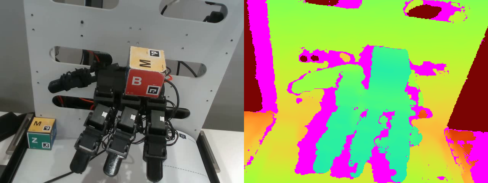

# RealSense D435 set-up and feed check, 25 Nov 2026

**Status:** the camera works end to end with the cube-vision pipeline (`docs/live_vision_digital_twin.md`), using the D435's built-in factory calibration. Telemetry from the hand flows through the dashboard to the kit viewer, and each trial's rotation can be measured from the recording afterwards. Still open: the cube marker layout is unconfirmed, and the camera-to-palm transform is not calibrated (Section 5).



## 1. Camera

| Item | Value |
|---|---|
| Device | Intel RealSense D435, serial 137322071897, firmware 5.17.3.10 |
| Connection | USB 3.2, full bandwidth for colour + depth |
| Access | `/dev/video*` through the logged-in session (uaccess); no group change needed |
| Software | `uv sync --extra hardware --extra vision --extra realsense` (opencv-contrib 4.14, pyrealsense2 2.59). All three extras together: syncing `vision`/`realsense` alone would uninstall the hand's `hardware` extra. |

## 2. Calibration used: factory intrinsics

These are read from the device by the SDK (`real_world/camera_configs/realsense_d435_137322071897_<res>.intrinsics.json`). Live RealSense mode reads them automatically; the files are saved for replay and for the record.

| Stream | fx | fy | cx | cy | Distortion |
|---|---|---|---|---|---|
| 1280×720 (**used**) | 908.8 | 908.3 | 644.4 | 372.1 | 0 (inverse Brown–Conrady) |
| 640×480 | 605.9 | 605.5 | 322.9 | 248.1 | 0 |

- **Status:** `device_factory_unverified`.
- **Optional verification:** a printed ChArUco board, `calibrate-intrinsics --camera realsense`, then `verify-device-intrinsics` (guide §6.1). This changes the label to `device_factory_verified` if the two agree within 1 px.

## 3. Feed check (cube on the hand, static)

| | 640×480 | **1280×720** |
|---|---|---|
| Frame rate | 28 fps | 28 fps |
| Full multi-face tracking (TRACKING) | 34% | **50–59%** (rest PARTIAL; no LOST) |
| Depth fused with the colour (RGB_D_FUSED) | 72% | **91–97%** |
| Marker size in the image | about 23 px | about 35 px |

- **Geometry:** cube about 0.40 m from the camera; 81% of pixels have valid depth. The hand and cube are clearly separated from the mounting plate.
- **Static cube:** −0.01 quarter turns over 8 s, valid pose in 99.6% of frames.
- **Recording size:** about 8 MB/s at 720p with depth, so roughly 20 GB for a 40-minute session (96 GB free). It is stored under `outputs/`, which is not in git.

**Issue: a second cube was in view.** All cubes carry the same marker IDs (M, B, Z, …), so the tracker merges them. In this check, 226 of 227 frames raised a layout conflict, so the check says nothing yet about the hand cube's layout. **Keep exactly one cube in the camera's view.**

## 3b. Flicker diagnosis and fix (25 Nov, session `outputs/cube_vision/live_20261125_104741`, one cube, static, no robot)

**Symptom:** the dashboard's cube pose flickered.
- With the default `layout.json`, 1,402 of 1,416 frames raised a layout conflict: the visible faces M, B and U contradicted each other.
- The tracker fell back to single faces, so only 2% of frames were multi-face.
- The two-fold single-face (IPPE) ambiguity then flipped the orientation by about 177° between frames in 54% of frames, with 668 state switches and only 46.5% TRACKING.

**Dictionary and IDs:** correct. Every detection decodes as `DICT_4X4_50`, the IDs seen are 0 (M), 1 (B) and 3 (U), and there are no unknown IDs.

**Marker size, measured with depth** (marker corners from colour, metric plane from aligned depth, every 10th frame): face B, the one facing the camera, measures **15.38 mm** (IQR 15.27–15.44) against the specified **15.55 mm**, i.e. −1%, within the D435's depth accuracy at 0.4 m. Faces M and U are seen too obliquely for a depth measurement (14.3 mm; wide spread). The size is not the cause.

**Layout:** `verify-layout` on this recording finds every co-visible pair (M–B, M–U, B–U) inconsistent with `layout.json` (180° on each). Its reconstruction fits at 0.58 px and is **identical (0.0°) to the candidate** `assets/mbzuai_cube/measured/layout.measured_rgb.json`, which was found from `evidence/videos/rgb.mp4`. That is an independent confirmation for M, B and U. Z, A and I were not visible and still rest on `rgb.mp4` only.

**Fix:** the dashboard now uses the measured layout and print layout by default (`LEAP_VISION_ARGS` in `configs/hand.env`), with `--no-twin`.

| Same recording, re-tracked | `layout.json` (live) | Measured layout |
|---|---|---|
| TRACKING | 46.5% | **100%** |
| Layout conflicts | 1,402 | **0** |
| Ambiguous poses | 299 | **0** |
| Frame-to-frame orientation change > 30° | 54% | **0%** (median 0.18°) |
| RGB-D fused | 72% | **100%** |

A live headless check with the new defaults gave 27.4 fps, 100% TRACKING, 0 conflicts and 100% RGB-D fused. Earlier, the live GUI ran at only 13 fps with the twin on.

**Still to do:**
- Show faces Z, A and I to the camera once, by turning the cube slowly in front of it, and re-run `verify-layout` to confirm all six faces.
- Measure the marker offset with calipers.
- Then decide with the team whether to adopt the measured layout as `layout.json`. That file is unchanged.

## 3d. All six faces confirmed; per-face marker offsets (session `live_20261125_110023`, C5s3 run at 11:01)

**Faces:**
- During the C5s3 run the camera saw faces M, Z, A and I.
- `verify-layout` on that recording matches the measured candidate **exactly (0.0°) on every new pair**: M–Z, M–A, Z–A, Z–I, A–I. `layout.json` is 180° off on each.
- Together with this morning (M–B, M–U, B–U), **the measured layout is confirmed on all six faces by two independent recordings**. `layout.json` is still unchanged; adopting the measured layout is a team decision.

**Remaining conflicts:** 150 of 1,031 frames, all of them with only Z and A visible (two oblique side faces).
- **Cause:** the stickers are not placed identically on every face. Fitted per-face marker offsets differ by up to about 4 mm.
- **Effect:** the conflict frames still change orientation by only about 1.5° per frame, with no jumps.

**Per-face offsets** (`assets/mbzuai_cube/measured/marker_print_layout.measured_perface_20261125.json`):
- **Where they come from:** fitted by `verify-layout`'s bundle adjustment. M, B, Z and A use their own fits.
- **U and I use the shared mean:** their free fits put the marker past the face edge, which is physically impossible; U was seen only obliquely and I in just 64 frames. The tracker refused that file.

| Re-tracked | Static session: conflicts / reprojection | Manipulation session: conflicts / ambiguous / reprojection / TRACKING |
|---|---|---|
| Shared offset (measured candidate) | 0 / 1.39 px | 156 / 27 / 0.66 px / 94.5% |
| Per-face offsets | 0 / **1.07 px** | **44** / 25 / **0.55 px** / 95.0% |

- **The improvement is in-sample:** the offsets were fitted on these same recordings. Measure the offsets with calipers to confirm.
- **Dashboard default:** the per-face file, because it is never worse on either recording (`LEAP_VISION_ARGS`).

## 3c. Occlusion by the fingers (`real_world/cube_vision/gapfill.py`)

**Problem:** during manipulation the fingers hide the cube for moments.
- In the hand-held recording, the cube is hidden 23% of the time, in 54 gaps (p90 1.1 s, max 3.8 s).
- The dashboard's rule bridges a gap only if it lasts ≤ 0.5 s and the turn is < 120°; otherwise it drops the interval. That excluded 15.7 s (20%) of the recording, and its rotation was never counted.

**Method** (offline, used by `scripts/vision_trials.py`):
- **What is known after a gap:** every face has its own marker ID, so the orientation after re-acquisition is known exactly. The rotation during the gap is known up to whole turns: θ_short + 2πk.
- **Choosing the whole turns:** k comes from the rotation speed on **both** sides of the gap (constant-acceleration interpolation).
- **How big the uncertainty is:** it is **learned from the session itself**. Intervals of 0.3–3 s are hidden inside its own visible motion, and the prediction errors set the model's unpredictability. Smooth gaits give tight bounds; erratic ones give wide bounds.
- **Resolved or ambiguous:** a gap is *resolved* when P(wrong branch) < 1%. Otherwise it is *ambiguous*: the best branch is still used, the reported range widens by a whole turn either way, and the gap's time is listed so it can be checked in the recorded video.
- **Rotation about the axis** is the swing–twist "twist", so wobble and tilt do not count.

**Validation** (`scripts/validate_gapfill.py`, `real_world/cube_vision_gapfill_validation.json`):

| Test | Old rule | Gap-aware |
|---|---|---|
| Real recording, a 0.5–3 s interval hidden inside continuous tracking (31 windows) | wrong (> 45°) in 0% (median error 0.5–1.2°) | wrong in **0%**; median error **0.0°**; the 1.5–3 s hides are correctly flagged when the speed was too uncertain |
| Real recording, natural gaps, whole video | +0.7 quarter turns (long gaps dropped) | **+1.4** quarter turns; 16 of 18 gaps resolved |
| Synthetic stress test: 200 × 60 s, 27% hidden, gaps up to 4 s, speed changes and reversals, wobble, pose noise | median error 5.9 quarter turns per 60 s; ≥ 1 turn off in 92% of sequences | median error **0.05**; every sequence that was off had a flagged gap (no silent errors) |

- **The synthetic test is harsher than reality:** its learned unpredictability is 1.6 rad/s², against 0.52 for the real recording.
- **Live display:** the dashboard's live count still uses the old rule. Use `vision_trials.py` for the trial numbers.

**Iterative refinement for robot gaits:** on the hand, the cube is visible only in short bursts.
- **The pattern in trial 1** (C5s3, 25 Nov): median visible burst 0.3 s, 52 gaps (median 0.25 s, max 3.6 s), cube hidden 41% of the loop.
- **Why one pass was not enough:** speeds from 0.3 s bursts are unusable, so the first version found only 4 calibration windows, fell back to a cautious default, and flagged 11 gaps (range [−27, +61] quarter turns).
- **What it does now:**
  1. resolve the near-certain short gaps;
  2. join the bursts across them;
  3. re-estimate the speeds over 1.5 s of the joined series;
  4. re-learn the predictability from it;
  5. repeat until nothing changes.
- **Trial 1 now:**
  - 55 calibration windows;
  - **17.0 camera quarter turns, range [+5, +29], 3 ambiguous gaps** (at 1.6–5.2, 35.6–37.8 and 46.8–48.6 s; check them in the video);
  - the operator counted 16;
  - the old rule gave 14.1.
- **Synthetic stress test after the change:** 29 of 200 sequences off by ≥ 1 quarter turn, every one of them with a flagged gap (no silent errors).

**Physical option:** with the camera **above the palm, looking down**, the top face (which stays on top during the spin) would be visible almost all the time. That removes most gaps at the source.

## 4. Using it in trials

**Per-trial recording (from trial 4 on 25 Nov).** With `LEAP_USE_VISION=1`, every `./leap.sh trial` opens its own camera panel and recording. Do not run `./leap.sh vision` at the same time: both use the camera and the UDP port.

```bash
cd ~/Documents/AnyDesk/Dexterous-In-Hand-Manipulation/LEAP_Hand_RL_Deploy_Kit
export LEAP_USE_VISION=1 LEAP_TRIAL_PLAN=c5seeds LEAP_TRIALS_CSV=$PWD/logs/trials_20261125.csv
./leap.sh trial C5s3            # or: trial next / trial C5 / ...
```

Each trial, in order:
1. The camera panel opens and recording starts into `outputs/cube_vision/trial_<date>_<time>_n<trial#>_<policy>/`. The trial waits until the camera is up; if the camera fails, the trial does not start.
2. The run proceeds as before (YES prompt, kit viewer). The hand's telemetry is routed through the panel.
3. When the run ends (time-out, Ctrl+C or a guard stop), the camera stops and closes `recording/rgb.mp4` and `frames.csv`.
4. The trial is recorded. The camera result is then printed: gap-aware quarter turns for every trial in the CSV. The per-trial plot and series are written next to the trials CSV as `<trials>_trial<N>_vision.{png,csv}` and `..._gaps.csv`.
5. `scripts/trial_video.py` re-tracks the trial with the region and range guards. It then fills every frame: MEASURED, RESOLVED_1FACE, ESTIMATED, ESTIMATED_UNCERTAIN (±1 turn) or NOT_VISIBLE. The results go to `<trial dir>/refined/`. `vision_trials.py` then uses these refined poses.
6. In the background, the panel video renders to `<trial dir>/dashboard_estimated.mp4`, in real time. It runs from 5 s before the policy starts to 3 s after the run ends. Where the cube is hidden, an orange dashed cube is drawn; it is red when the number of turns is uncertain. A status bar shows the state, turns and speed. Set `LEAP_VISION_DASHBOARD_VIDEO=0` to skip the render.

If you answer "no" at YES, nothing is recorded in the CSV, but the short camera folder is kept.

**Verified without moving the hand:**
- The camera starts, the YES prompt is answered "no", and the camera stops on SIGINT. The recording was valid: `rgb.mp4` had 41 frames, matching the 41 rows of `frames.csv`, plus `summary.md`.
- The analysis command ran on today's trials CSV.
- The dashboard render ran on that recording and produced `dashboard.mp4`.

**Older two-terminal mode:** `./leap.sh vision` in terminal 1, then the trials with `LEAP_USE_VISION=1` in terminal 2 but without this per-trial camera. This is no longer needed.

```bash
# after the session: camera rotation per trial, next to the operator's counts
cd .. && uv run --extra vision python scripts/vision_trials.py \
    --trials LEAP_Hand_RL_Deploy_Kit/logs/trials_20261125.csv \
    --vision 'outputs/cube_vision/trial_*' 'outputs/cube_vision/live_*' --axis-sign-from-trial <a trial you saw turning the trained way>
```

- **Tested without the hand:** the real camera plus a simulated-bus run.
  - The dashboard attached the hand's telemetry to the frames.
  - All 100 datagrams were relayed with the monitor fields.
  - Depth was fused in 96% of frames.
- **The dashboard is read-only.** It never commands the hand.
- **What `vision_trials.py` reports:**
  - camera quarter turns per trial, over the whole policy loop and up to the drop time;
  - pose coverage and excluded gaps.
- **Rotation axis:** one fixed rotation axis for the session, estimated from all trials, because camera-to-palm is not calibrated. Magnitudes are comparable across trials; the sign is fixed by naming one trial that turned the trained way.
- **Tested** on synthetic data with a known answer (`tests/test_vision_trials.py`: per-trial turns, reverse direction, drop cut-off and occlusion bridging) and on the real static recording.

## 4b. Trials 4–5 review: a second cube, frame rate, and filling hidden frames

- **A second MBZUAI cube was on the table, lower left of the image.** It carries the same marker IDs. Its markers were rejected as "layout conflicts" in 209 of 556 frames in trial 5, and in some frames the tracker followed it (Z 0.85 m instead of 0.41 m). A few poses were even reported behind the camera (Z −10¹² m), which crashed the old video render.
  - **Fix:** markers are now detected only inside `--roi 400,0,1280,720`, and poses outside (0.05, 0.7] m are dropped (`LEAP_VISION_GUARD_ARGS`).
  - Still keep only one cube in view.
- **Frame rate.** The live loop recorded only about 11 fps:
  - tracking 15 ms, panel drawing 33 ms and depth PNG 10 ms per frame, all in series;
  - `rgb.mp4` was tagged 30 fps, so replays played 2.7× too fast.
  - **Fix:** the panel is redrawn at 10 Hz (`--display-hz 10`), and the recorder writes in a background thread. The loop now handles about 94 fps offline, without depth.
  - Old recordings could also lose the last frame's timestamp on stop. The threaded recorder cannot split a frame from its timestamp.
- **What the missing frames were** (trial 5, after the region filter): 141 frames with no marker found, 4 single-face ambiguous frames.
  - The lost frames are hidden or blurred markers.
  - A tuned ArUco detector found markers in only 22 more frames and added 117 false IDs, so it was not adopted.
- **Results for the policy window:**

| trial | measured | 1-face resolved | estimated | uncertain | camera qt [range] | operator qt |
|---|---|---|---|---|---|---|
| 1 | 58% | 2% | 40% | 0% | 16.2 [8.2, 24.2] | 16 |
| 4 | 72% | 2% | 26% | 0% | 0.8 | 2 |
| 5 | 61% | 1% | 31% | 8% | 7.0 [3.0, 11.0] | 8 |

- **Tested:** `tests/test_vision_trials.py::test_fill_estimates_hidden_frames_and_resolves_one_face_flip`. A synthetic spin hidden for 1.2 s: the estimated orientation stays within 10° of the truth, and the single-face flip resolves to the truth.

## 5. Before trusting the camera's rotation counts

1. **Confirm the cube layout.** `layout.json` does not match the physical cube (guide §2). With the default layout, the tracker falls back to single faces, and switching faces can make the orientation jump. Record the hand's cube **alone**, turned slowly by hand so that every face is seen, then check it:

   ```bash
   uv run --extra vision --extra realsense python scripts/cube_vision.py live --camera realsense --width 1280 --height 720 \
       --headless --no-twin --record --max-seconds 40 --out outputs/cube_vision/layout_check_20261125
   uv run --extra vision python scripts/cube_vision.py verify-layout \
       --video outputs/cube_vision/layout_check_20261125/recording/rgb.mp4 --out-dir outputs/cube_vision/layout_check_20261125/verify
   ```

   If it confirms the candidate (`assets/mbzuai_cube/measured/layout.measured_rgb.json`), run the dashboard with it:

   ```bash
   export LEAP_VISION_ARGS="--camera realsense --width 1280 --height 720 --fps 30 \
     --layout training_source/project/assets/mbzuai_cube/measured/layout.measured_rgb.json \
     --print-layout training_source/project/assets/mbzuai_cube/measured/marker_print_layout.measured_rgb.json"
   ```

2. **Validate against the operator's counts.** For the first session, compare the camera quarter turns with the counted ones, trial by trial.
3. **Camera-to-palm (optional; needed for the palm-frame pose and the vision-vs-estimator comparison).** This needs a jig with physically known cube poses (guide §6.2). Until then, rotation is measured about the motion's own axis, and no palm-frame position is reported.
