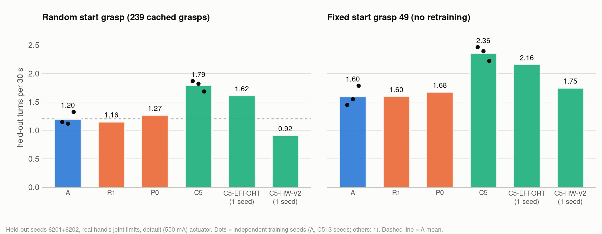
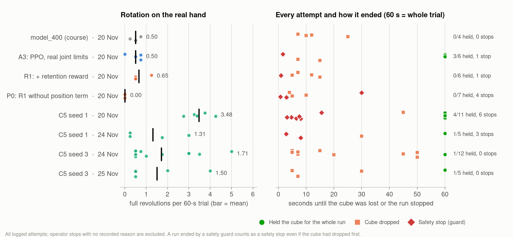
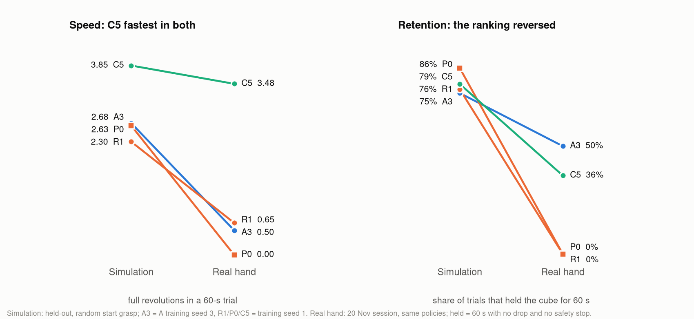
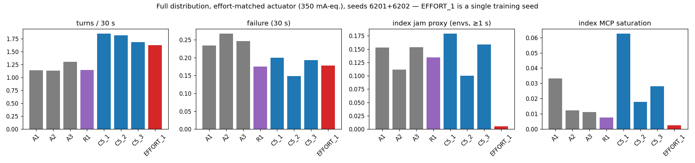
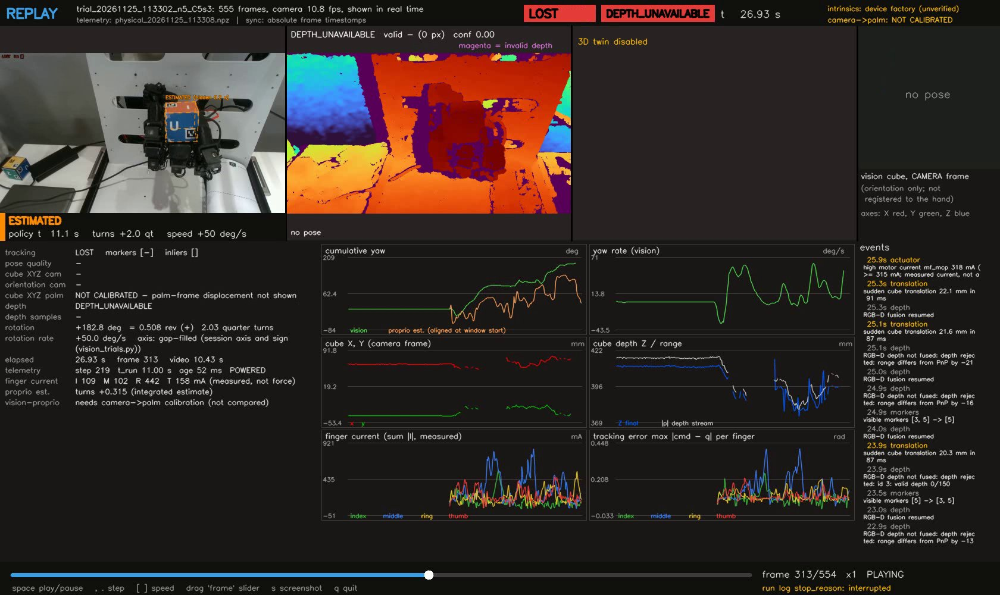

# What transfers? Sim-to-real for sensorless in-hand cube rotation on the LEAP Hand

*Draft project report. Every number is traceable to a file in this repository; see [NUMBERS.md](NUMBERS.md).*

## Abstract

A right LEAP Hand rotates a 58 mm cube about the vertical axis using only its joint readings and its own previous commands: no camera, tactile sensor or cube pose enters the policy. Starting from a course baseline (`model_400`), this report covers seven simulation studies with PPO in MJLab on MuJoCo Warp and five supervised real-hand sessions. Four bugs in the course training environment were fixed first. Cube state estimated from proprioception gave a gain under the course's wide joint limits that was not statistically established (+0.150 turns [−0.006, +0.339]), and none under the hand's real limits (C − A = −0.041 [−0.150, +0.055]). Raising the clip on the yaw reward (policy C5) gave +0.593 turns per 30 s over the baseline [+0.354, +0.833] across three training seeds. On the hand, C5 made 3.48 full revolutions per 60-s trial against 0.50 for `model_400` (operator counts, n = 5 and 4). Rotation speed transferred. A retention reward and the proprioceptive cube-yaw estimate did not. An offline actuator audit traced C5's safety stops to index-finger jams at the hand's 350 mA current limit, which training (550 mA) never saw. A single-seed retraining from simulated kit starts (C5-HW-V2) failed all three of its pre-registered criteria.

## 1. Introduction and contributions

In-hand rotation without object sensing suits low-cost hands: the policy needs only the motor encoders. Proprioception-only rotation can be learned in simulation and transferred [1], and touch or vision can extend it [3, 4]. This project starts from a course package: a trained continuous-yaw policy (`model_400`), its MJLab training task, and a guarded deploy kit for a right LEAP Hand [2]. The question is empirical and narrow: **which simulation improvements survive the transfer to the real hand, and which sim-to-real gaps can be measured with the hand's own logs?**

Contributions:

1. **Four bugs in the course training environment**, fixed and unit-tested (Section 3).
2. **A controlled test of proprioceptive cube-state estimation for PPO** (conditions A/B/C/D, three seeds each): a gain that was not statistically established under the course's joint limits and disappeared under the hand's real limits (Sections 4–5), plus a sensorless fingertip-force estimator (Section 4.3).
3. **Two separable simulation improvements**: a fixed start grasp (cache index 49) and a higher yaw-reward clip (C5), the latter confirmed over three training seeds (Section 6).
4. **A real-hand evaluation with every attempt logged**, safety stops included (Section 7).
5. **An offline actuator audit** that explains C5's safety stops and measures the actuator lag, followed by an effort-matched retraining, C5-EFFORT, and a combined retraining from simulated kit starts, C5-HW-V2, that failed its pre-registered criteria (both single-seed exploratory; Section 8).
6. **A camera measurement pipeline** with gap filling for frames in which the fingers hide the cube (Section 9).

## 2. Task and setup

### 2.1 Hand, cube and policy interface

**Hand.** A right LEAP Hand [2] with 16 Dynamixel motors (IDs 0–15), driven by the course deploy kit. The kit's guards were never changed: a 350 mA current limit set in the motor register, an abort if any motor current exceeds 450 mA, an abort if tracking error exceeds 0.65 rad after step 10, a velocity abort at 8 rad/s, a 60 °C temperature limit, and an abort on any command step above 0.05 rad. Each policy needed a torque-off shadow pass before a powered run.

**Cube.** The 58 mm MBZUAI cube, whose six faces carry 15.55 mm ArUco markers (`DICT_4X4_50`). Only the camera pipeline (Section 9) uses them.

**Observation.** 320 dimensions: 10 frames of the 16 measured joint positions (relative to the default pose; in simulation with ±0.01 rad noise and a 0–1 step delay) and 10 frames of the 16 previous commanded joint targets. The policy never sees the cube.

**Action.** A 16-D Gaussian sample *u*. The executed action is tanh(*u*), mapped to a per-step joint-target change of at most ±1/24 rad (0.0417 rad), integrated and clamped to the joint limits.

**Control rate.** 20 Hz (physics step 0.005 s, decimation 10). The hand's loop measured 50.2 ms per step on 17 Nov.

### 2.2 Simulation and training

Training used MJLab [11] on MuJoCo Warp (MuJoCo [9]); the course's pinned nightly build was replaced by `mujoco==3.8.1` and `mujoco-warp==3.8.1`. The task rewards continuous +Z rotation of the cube: a drift-gated yaw rate clipped to ±0.25 rad/s (weight 1.25; ×0.1 outside 2 cm / 0.35 rad), with penalties on cube linear velocity (L1, −0.3), joint-pose deviation beyond 0.4 rad (−0.1), torque² (−0.1), work (−0.05) and a fallen cube (−10). The penalty weights follow a progress curriculum during training. Episodes start from grasp-cache states with random yaw and end on a 20 s time-out, the cube falling below 0.2 m, the cube moving faster than 1 m/s, or a pose failure (tilt above 0.8 rad or drift above 0.08 m). Domain randomisation [7] covers cube mass (×0.7–1.4), friction (0.6–1.4), cube centre of mass (±2 mm), link mass, joint friction, damping, armature, PD gains, actuator delay (5–15 physics steps) and effort limit (×0.9–1.1).

PPO [8] ran through rsl_rl with massively parallel simulation [10] (4096 environments, 32 steps each, adaptive learning rate from 1e-3, desired KL 0.01). Actor and critic are 512-512-256 ELU networks; the critic receives an 83-D privileged state, and the actor's last layer starts at zero. The budget was 1001 updates (131.2M environment steps) in the first study and 3001 updates (393 M environment steps) from 17 Nov onward. Runs used NVIDIA RTX 5000 Ada GPUs on a Slurm cluster.

### 2.3 Evaluation protocol

- **Primary metric:** *uninterrupted turns*, the net +Z rotation of the cube until the first termination, divided by 2π, over a 30-s window from a reset. Rotation is accumulated with a singularity-free yaw increment (Section 3). Secondary metrics are the failure rate, the yaw rate while held, 60-s turns and P(held 60 s).
- **Selection and test:** checkpoints are selected by maximum turns on validation seed 7001 (1024 environments, nominal physics). Held-out test seeds are used once: 5001/5002 in the first three studies, 6201/6202 from the grasp study on. Robustness presets change the physics beyond the training ranges (for example *heavy_slippery*: cube mass ×1.3–1.8, friction 0.4–0.7).
- **Statistics:** the unit of replication is the training seed, mostly three per condition, with bootstrap or Welch confidence intervals; with n = 3 these are coarse.
- **Pre-registration:** from the 17 Nov study onward, each protocol, its thresholds and its evaluation seeds were written before training and hashed (`PROTOCOL*.md`, `logs/*.sha256`).
- **Deployment parity:** each policy is checked numerically between the kit's NumPy runtime and the training actor (≤ 3.1e-5 for the hardware-limited policies) and rehearsed in closed loop in simulation through the kit runtime.
- **Real hand:** the cube is placed by hand during a 5 s countdown with torque off, the fingers ramp for 5 s to the kit's default grasp pose, then the policy runs for 60 s. The operator records quarter turns counted by eye, drops with approximate times, and notes. Every attempt is logged; safety stops count as failures.

### 2.4 Related work

**Proprioception-only rotation.** HORA [1] learns in-hand object rotation in simulation and transfers it to a real hand using proprioception alone; an adaptation module infers a latent description of the object from the proprioceptive history, following Rapid Motor Adaptation for legged robots [5]. The estimator in Section 4 is in the same spirit, but predicts explicit cube state (pose, velocity, contacts) and feeds it to the policy instead of a learned latent.

**Touch and vision.** Yin et al. [3] rotate objects using touch sensing and no vision. RotateIt [4] combines vision and touch for general in-hand rotation. This project has neither; the camera in Section 9 is a measurement instrument, not a policy input.

**Sim-to-real for dexterous hands.** OpenAI's Dactyl work [6] showed that dexterous in-hand manipulation learned in simulation can transfer to a physical hand when the simulator is heavily randomised [7]. This work keeps the course's randomisation and instead measures specific mismatches on the real hand.

**Hardware and tooling.** The LEAP Hand [2] is a low-cost anthropomorphic hand designed for robot learning. Training uses PPO [8] with thousands of parallel GPU environments [10], here through MJLab [11], MuJoCo [9], MuJoCo Warp and rsl_rl.

## 3. Problems found in the course environment

**Running the baseline faithfully (11 Nov).** The course's portable MuJoCo scene placed the hand 10 cm lower than MJLab does, which caused an earlier "−2.4 turns" result. After the fix, the recorded `model_400` trajectory (seed 11) shows 1.31 turns in 30 s.

**Four bugs in the training environment (12–13 Nov).** Each fix lives in new modules; the original task was left untouched.

1. **Stale reset anchor.** The pose-deviation termination stored the episode's initial cube pose inside its reset hook. MJLab runs manager resets before `sim.forward()`, so the stored pose was the previous episode's final pose. New episodes terminated at once, in a cascade. Fix: take the anchor after the first physics step of the new episode.
2. **Singular Euler-angle tilt.** Tilt was the norm of wrapped roll and pitch differences in XYZ-Euler angles, which is singular near |pitch| = 90°. Every episode whose cube spawned with |pitch| ≥ 30° (about half of the grasp-cache starts) was terminated, 98–100% of them, after only 7–32° of real tilt. Fix: physical tilt, arccos(u(q) · u(q₀)) with u(q) = R(q)ᵀe_z, which has no singular orientation.
3. **Euler-yaw rotation measure.** Reward and evaluation differenced the Euler yaw angle. It is ill-defined near |pitch| = 90°, and differencing across resets counted teleports as rotation. Fix: the *genuine yaw increment*, the z-component of the rotation vector of q_t ⊗ q_{t−1}⁻¹. A test confirms that a 120° reset teleport yields zero reward.
4. **Action saturation.** The wrapper clipped the Gaussian sample to ±1, while PPO stored the unclipped sample and its log-probability. The mean therefore drifts beyond the clip. In `model_400`, 95% of action entries were saturated, the median |μ| was 12.8, and 94% of exploration samples left the executed action unchanged. Fix: execute tanh(*u*), which keeps the PPO likelihood ratio exact.

The fixes are covered by 17 CPU and 5 GPU tests. The project also caught **its own bug**: in the first estimator-augmented (C) runs, the script zero-initialised the frozen estimator's output head instead of the policy's, so the features were constant. A feature ablation exposed it; all C seeds were retrained, and a regression test guards the fix.

## 4. State estimation and force estimation

### 4.1 Conditions and estimator B

Four conditions share the environment of Section 3 and the 320-D proprioceptive input:

| Condition | Actor input | Deployable |
|---|---|---|
| A | proprioception only | yes |
| B | not a policy: an MLP from the same input to the cube state | yes |
| C | proprioception + 19 features from the frozen estimator B | yes |
| D | proprioception + the same 19 features from simulator ground truth | no (oracle) |

The features are palm-frame position, a symmetry-canonical rotation, linear and angular velocity, and fingertip-contact probabilities. Estimator B is an MLP (320 → 512-512-256, LayerNorm, ELU) trained with a symmetry-aware rotation loss over the 24 cube rotations, on 5,529,600 rows from A seeds 2 and 3, and tested on 1,536,000 rows from A seed 1, a policy whose data it never saw.

On that held-out policy, B estimates cube position to 10.2 mm RMSE and orientation to 16.8° mean, against 15.2 mm and 39.2° for a ridge regression. Contacts reach micro-F1 0.79. Velocity is poorly observable (R² 0.41 linear, 0.35 yaw rate). In closed loop, errors on the two training policies are about 5.6 mm and 7°; on any unseen policy, C's own included, they roughly double to 9–16 mm and 12–20°.

### 4.2 Does estimated state help PPO?

All conditions were trained from scratch with three seeds and 1001 updates, and tested on held-out seeds 5001/5002 under six physics presets.

| Pooled over 6 presets (3 seeds each) | Turns in 30 s | Difference [95% CI] |
|---|---|---|
| A (proprioception) | 0.756 | — |
| C (estimated state) | 0.906 | C − A +0.150 [−0.006, +0.339] |
| D (oracle state) | 1.018 | D − A **+0.263 [+0.148, +0.376]** |
| | | D − C +0.113 [−0.075, +0.276] |

The ranking D > C > A holds in every preset. Estimated state recovers about 57% of the oracle gain, but its CI just includes zero and one C seed is no better than A. Learning speed is the clearest effect: every C and D seed has a higher mean validation curve than every A seed (C 0.686 vs A 0.473; one-sided permutation p = 0.05). No run had converged at 1001 updates.

C uses its features: replacing them with zeros, their mean or another environment's features cut its turns to 19–71% of normal, and shuffled (plausible but wrong) features were the most damaging.

### 4.3 Sensorless fingertip force

A second estimator predicts the normal force on each fingertip from the same 320-D input (labels from a passive MuJoCo contact sensor; B's trunk with a contact-probability × magnitude head; trained and tested on disjoint policies). On unseen policies it reaches MAE 0.187 N and R² 0.78, against 0.301 N for ridge regression; contact AUROC is 0.94–0.98. The main generalisation gap is the policy, not the physics: MAE rises 61% from seen to unseen policies, while the five robustness presets add only 0–12%. Forces above about 2 N are underestimated. On the hand, which has no force sensor, the estimated thumb force correlated with the thumb's summed motor current (18 Nov: r +0.23 to +0.44 in all 5 runs) and the index estimate did not (r −0.18 to +0.17). This supports contact information, not newton values.

## 5. Hardware constraints: joint limits and A vs C

**First session (17 Nov).** A function test passed, and `model_400`, A seed 2 and C seed 2 ran without guard trips (current ≤ 390 mA). Cube rotation was not measured. The main finding: the kit clamps the sideways (rot) joints to ±0.52 rad, while the policies were trained with ±1.05 rad. On the hand, at least one joint was commanded at the controller limit in 87–98% of the steps of every run. In a closed-loop rehearsal of the kit runtime, the limits cost A 0.14 turns but C 0.59 turns, so C (0.53) fell below A (0.62); without them, C reached 1.01 and A 0.72.

**A vs C under the real limits (17–18 Nov, pre-registered).** Both conditions were retrained from scratch with the kit's limits applied to the integrated command, three seeds each and 3001 updates. The original grasp cache was mostly infeasible under the limits (only 10 of its 449 grasp commands lay inside them), so a new cache of 239 settled grasps was built; its 10-s retention is 98.1%, against 95.4% for the original cache in the original environment.

| Held-out, nominal (seeds 5001+5002) | A | C | C − A |
|---|---|---|---|
| Turns per 30 s, per seed | 1.163 / 1.141 / 1.326 | 1.135 / 1.225 / 1.147 | |
| Mean | 1.210 | 1.169 | −0.041, bootstrap [−0.150, +0.055], Welch [−0.253, +0.170] |
| Failure rate | 0.241 | 0.256 | +0.014 [−0.020, +0.049] |

C − A lies between −0.06 and 0.00 under every physics preset, and every CI includes zero. Learning speed is also the same (mean validation turns over updates 100–3000: A 0.98, C 0.95). Four of the six runs met the pre-registered plateau criteria; the other two missed them narrowly.

A possible contributor is that estimator B no longer matched the new gaits: its errors grew 1.36–1.53× (position 11.0–11.8 mm against 8.1 mm), failing the study's reuse rule; a retrained estimator was proposed but not run. Rehearsal also found that the kit lets finger PIP joints go to 1.885 rad while training clamped them at 1.825 rad (cost to C seed 2: −0.19 ± 0.08 turns; a narrowing-only fix awaits approval).

**Second session (18 Nov).** The hardware-limited A and C (seed 1 each) ran two 30-s trials each; the estimated cube rotation was near zero in every run (−0.25 to +0.04 turns), so no A vs C comparison was possible. Control-loop jitter (19–22% of steps over 60 ms) was most likely a reset USB latency timer; with it set to 1 ms, 20 Nov had 4.9% late steps.

## 6. Start grasp and reward balance

### 6.1 Retention-V1

In simulation, 99.4% of the hardware-limited A policies' failures are tilt failures, they come early (median 6.4 s), and the start grasp largely decides them (per-grasp survival correlates 0.81–0.83 between A seeds). A retention reward was added: a one-sided penalty (weight −0.05) when the cube leaves the useful palm region or tilts beyond 0.5 rad, plus −10 when a pose failure fires. One policy, R1, was trained.

R1 lowers the held-out nominal failure rate from 24.1% to 17.2% (−29%), with lower failure in every preset. Turns do not improve (1.164 vs 1.210; −0.046 [−0.155, +0.031]) because R1 rotates 11% more slowly while holding the cube. By the pre-registered rule this is Outcome B; the turns target (≥ 1.39) was not met.

### 6.2 Start grasp (no retraining)

Rolling out all 239 cache grasps with existing policies showed that grasp quality is a property of the grasp, not the policy (split-half reliability 0.99; initial cube tilt predicts it, Spearman ρ = −0.70). Grasp 49 was chosen by a pre-registered rule. Starting every episode from grasp 49 raises the mean held-out turns of the four existing policies from 1.189 to 1.599 (+34%) and cuts failure from 23.6% to 0.7%, with no retraining. With ±2 mm and ±10° placement noise it keeps 94% of the turn gain. It is 0.28 rad RMS from the kit's start pose; reproducing it on the hand needs an unapproved kit change.

### 6.3 Reward balance: P0 and C5

Offline reward recomputation showed why R1 is slow. In matched states the difference is the policy, not the states. The yaw reward is saturated at its ±0.25 rad/s clip in 56–78% of steps, so it gives no gradient towards faster rotation, and the *position* part of the retention penalty flips the reward's preference from A-like to R1-like behaviour (A − R1 return: −0.050 as trained, +0.282 without it). Two candidates were pre-registered, each a single change from R1, and trained once:

- **P0:** R1 without the position part of the retention penalty;
- **C5:** R1 with the yaw clip raised from ±0.25 to ±0.5 rad/s.

| Held-out, full grasp distribution (6201+6202) | Turns / 30 s | Failure | Yaw rate held (rad/s) | P(held 60 s) |
|---|---|---|---|---|
| A, mean of 3 seeds | 1.200 | 25.2% | 0.295 | 0.732 |
| R1 | 1.158 | 19.0% | 0.263 | 0.763 |
| P0 | 1.273 | **11.5%** | 0.282 | **0.862** |
| C5 (seed 1) | **1.869** | 19.9% | **0.432** | 0.788 |

C5 passed all five pre-registered thresholds. P0 has the lowest failure rate but missed the turns threshold by 0.001: a retention improvement, not a rotation improvement. C5's joints move faster than the others' (+18%), flagged in advance as a sim-to-real risk.

### 6.4 C5 over three seeds

C5 seeds 2 and 3 were trained exactly like seed 1 and evaluated on the same held-out seeds.

| Seed-level comparison (Welch, 3 vs 3 seeds) | C5 − A [95% CI] | p |
|---|---|---|
| Turns / 30 s (C5 3-seed mean 1.793) | +0.593 [+0.354, +0.833] | 0.0025 |
| Failure / 30 s (C5 18.4%) | −0.068 [−0.122, −0.013] | 0.0268 |
| Yaw rate held | +0.117 [+0.067, +0.167] | 0.0031 |
| P(held 60 s) | +0.070 [+0.009, +0.131] | 0.0338 |

All three seeds pass all five thresholds. C5's failure rate does not differ from R1's (−0.005 [−0.070, +0.060]), so raising the clip did not trade away the retention gain of the R1 reward. The two improvements combine: from grasp 49, the C5 three-seed mean is 2.361 turns against 1.597 for A (+0.764 [+0.407, +1.120], p = 0.0047).

*Figure 1: Held-out turns per 30 s in simulation under the real joint limits (seeds 6201+6202). Left: random start grasp from the 239-grasp cache. Right: every episode starts from grasp 49, without retraining. Dots are training seeds (A and C5: 3 seeds; R1, P0 and C5-EFFORT: 1 seed each). The C5-EFFORT bars are a single-seed exploratory result evaluated under the default (550 mA) actuator; its decision-setting value under the 350 mA-equivalent actuator is 1.625 (Section 8.2). Source: `docs/figures/readme/sim_progress.png`, generated from `docs/figures/readme/headline_numbers.json`.*

## 7. Real-hand results: what transferred and what did not

### 7.1 Protocol

The 20 Nov session compared A3 (hardware-limited A, seed 3), R1, P0 and C5 seed 1, five 60-s trials each in a balanced Latin-square order, plus four trials of `model_400`, with gains H1 and a 1 ms USB latency timer. The cube was placed at the same spot each time: centre over the knuckle line, in line with the middle finger, the position of training grasp 49 (`docs/figures/cube_placement.png`); the kit then closes the fingers to its own default pose, not to grasp 49.

**Counting unit.** The operator counted quarter turns (90°); the 20 Nov session report predates this confirmation, so the audit's corrected full revolutions (quarter turns / 4) are used here.

### 7.2 20 Nov: four policies and the course baseline

The logs contain 37 attempts. The audit classified each into mutually exclusive categories:

| Policy | Attempts | Completed 60 s | Dropped | Guard stop | Operator stop, reason unknown | Full revolutions per trial (n) | Mean time held, recorded trials [s] |
|---|---|---|---|---|---|---|---|
| `model_400` | 4 | 0 | 4 | 0 | 0 | 0.50 ± 0.20 (4) | 13.5 |
| A3 | 7 | 3 | 2 | 1 | 1 | 0.50 ± 0.35 (4) | 40.6 |
| R1 | 6 | 0 | 5 | 1 | 0 | 0.65 ± 0.34 (5) | 9.2 |
| P0 | 9 | 0 | 4 | 3 | 2 | 0.00 (5) | 10.8 |
| **C5** | **11** | **4** | **1** | **6** | 0 | **3.48 ± 0.55 (5)** | 57.3 |
| Total | 37 | 7 | 16 | 11 | 3 | | |

*Figure 2: Real-hand attempts in the 20, 24 and 25 Nov sessions. Left: full revolutions per 60-s trial (operator counts; bar = mean). Right: time until the cube was lost or the run stopped. Operator stops with no recorded reason, the 24 Nov trial with operator intervention and the unrecorded 25 Nov run are excluded; a run ended by a guard counts as a safety stop even if the cube had dropped first, so P0 shows 3 drops and 4 stops here against 4 and 3 in the audit table above. Source: `docs/figures/readme/real_hand_attempts.png`, from `docs/figures/readme/headline_numbers.json`.*

**Speed transferred.** C5 rotated far faster than A3 (difference +11.90 quarter turns per trial [+9.85, +14.10], permutation p = 0.009, n = 5 and 4). While holding the cube, C5 turned at 3.64 full revolutions per minute on the hand, against about 3.7 rev/min in simulation; the policy that was fastest in simulation was also fastest on the hand. The other policies lost most of their simulated speed (Figure 3).

**Retention did not transfer.** R1 and P0 had the lowest simulated 30-s failure rates of the four (19.0% and 11.5%) and dropped the cube in all 5 recorded trials each, after about 10 s. R1 held the cube for 9.2 s on average against 40.6 s for A3 (−31.41 s [−51.76, −9.66], p = 0.069). The simulated ranking reversed: A3 held for the full minute in 3 of 6 attempts and C5 in 4 of 11, while R1 and P0 never did.

**C5 tripped a safety guard often:** 6 of 11 attempts, 5 of them the current guard (Section 8).

*Figure 3: Simulation vs real hand for the four policies of 20 Nov. Left: full revolutions in a 60-s trial (simulation: held-out 60-s turns, random start grasp). Right: share of trials that held the cube for 60 s (on the hand: no drop and no safety stop, operator stops with no recorded reason excluded). Simulation values are A seed 3 (A3) and seed 1 of R1, P0 and C5. Source: `docs/figures/readme/sim_vs_real.png`, from `docs/figures/readme/headline_numbers.json`.*

### 7.3 24–25 Nov: C5 seed 1 vs seed 3, and placement

The next session tested whether another training seed of the same recipe avoids the jam. Seed 3 was chosen **before** the session by a simulation screen with the motors capped at 350 mA (grasp 49, 256 environments): its index MCP/PIP were saturated 3.6% of the time against 7.5% for seed 1. Seed 2 moved the load to the middle finger and was not used.

On 24 Nov, seed 3 had **0 safety stops in 13 attempts**, against 3 of 5 for seed 1 (Fisher p = 0.012); including 20 Nov, seed 1 tripped a guard in 9 of 16 attempts (p = 0.001). In seed 1's stops the index MCP/PIP were again at ≥ 330 mA, 0.2–0.3 rad behind their commands. When seed 3 kept the cube for at least 20 s, it turned at 17.6 quarter turns per minute (n = 5; about 4.4 revolutions per minute), against 13.0 for seed 1 (n = 2).

Retention did not improve: seed 3 dropped the cube in 11 of 12 valid trials, bimodally (early drops at 5–7 s in 6 trials, holds of 45–60 s in 5). The operator attributed the early drops to the start placement; the logs cannot confirm this, since the hand pose after the closing ramp was identical in both groups (every joint within 0.008 rad). On 25 Nov, five more seed-3 trials repeated the pattern: one full run with 16 quarter turns and four drops at 5–30 s.

### 7.4 Proprioceptive estimators on the hand

Estimator B's integrated cube yaw was not grounded on the hand. Across 23 counted trials on 20 Nov, its correlation with the operator's counts was negative (Spearman −0.42). For C5, the operator counted 11–17 quarter turns per trial while the estimate gave −1.1 to −2.9 turns, with the wrong sign; for P0 it kept "rotating" after the cube had dropped. The estimate follows finger motion rather than the cube, consistent with B's degradation on the new gaits (Section 5) plus the real hand's shift.

## 8. Actuator audit → C5-EFFORT → C5-HW-V2

### 8.1 Actuator audit of the 20 Nov logs

An offline audit of all 37 run logs asked why C5 trips the guard.

- **The stops are index jams.** In 5 of C5's 6 guard stops, index MCP and/or PIP sat at the 350 mA current limit, 0.2–0.6 rad short of their command, for seconds; a transient of 453–747 mA then tripped the 450 mA guard. Every C5 run loads the index in its first 2–4 s; completed runs clear it by about 3.5 s, guard-stop runs never do.
- **Current and tracking error are the same signal.** The motor current behaves as a proportional controller of the position error, about 1,450–1,500 mA/rad, clipped at the limit, so it saturates at an error of 0.23–0.27 rad. Joint speed, abrupt commands and loop timing do not differ before stops.
- **Start transients are a separate mechanism.** Four guard stops of A3, R1 and P0, all within the first 2.9 s, were jumps of 300–850 mA within one control period at the handover from the closing ramp to the policy.
- **The training actuator had the wrong current limit.** The simulated actuator is current-mapped, and its gain matches the hand (1,440 vs 1,493 mA/rad for index MCP), but its current limit is 550 mA. With the frozen checkpoints and the effort limit set to the deployed 350 mA, C5 saturates the index MCP/PIP 7.6% of the time (P0 3.5%, A3 0.08%, R1 0.09%): the same policy ranking and the same joint as on the hand. Rotation barely changes (2.46 → 2.44 turns per 30 s), but simulation does not reproduce the persistence of the real jam.
- **The real actuator is faster than the simulated one.** The same lag estimator gives an effective lag of 80 ms on the hand (IQR 75–85 ms) and about 280 ms in simulation; simulated tracking error is about 3.5× larger. The earlier premise that the hand is slower than training is not supported.

### 8.2 C5-EFFORT (single-seed exploratory)

A C5 successor was specified with pre-registered criteria. Its primary condition makes two changes: (a) the effort-limit randomisation is lowered from 0.262–0.321 Nm (550 mA) to 0.167–0.204 Nm (350 mA × 0.53 Nm/A, ±10%), and (b) a smooth penalty −w Σ_j [max(0, u_j − 0.8)/0.2]² is added on actuator utilisation u_j = |τ_j| / limit_j, with w = 0.2201 calibrated before training to 10% of C5's rotation reward. **Only one training seed was run** (by instruction), so C5-EFFORT is a **single-seed exploratory** result: its confidence intervals are bootstraps over evaluation environments and say nothing about training-seed variation.

The decision setting is the full grasp distribution under the 350 mA-equivalent actuator, on held-out seeds 6201+6202, for every policy. The primary safety metric is a *jam proxy*: the share of environments with an index jam of at least 1 s (the audit's definition).

| Decision setting | C5-EFFORT (1 seed) | C5, 3-seed mean | Criterion | Result |
|---|---|---|---|---|
| Jam proxy, 60 s | 0.51% | 14.6% | reduction ≥ 50%, CI excludes 0 | 96.5% (CI 95.0–97.9%) |
| Turns / 30 s | 1.625 | 1.784 | ≥ 0.90 × C5 and ≥ 1.20 × A | 0.911 (CI 0.903–0.919); 1.362 × A |
| Failure / 30 s | 0.178 | 0.180 | ≤ C5 + 0.03 | met |

*Figure 4: Simulation under the 350 mA-equivalent actuator, full grasp distribution, seeds 6201+6202. EFFORT_1 (C5-EFFORT) is a single-seed exploratory run; C5_1–C5_3 are the three C5 training seeds. Source: `training_source/project/experiments/c5_hw_v1/figures/effort_v1_summary.png`.*

The pre-registered verdict is **SINGLE-SEED PASS (exploratory; not confirmed)**, with a small margin on rotation. On evaluation seed 6202 alone the rotation ratio is 0.899, and against the two faster C5 seeds it is 0.878 and 0.894. The reduction is effort avoidance, not a threshold artefact: joint samples above 80% utilisation fall to 0.83% (C5 seeds: 3.0–4.1%). Failure is unchanged; the cost is about 9% of rotation speed.

Caveats: the jam proxy does not separate A from C5 in simulation (13.9% vs 14.6%), although only C5 jammed on the hand, so its link to real guard trips is not validated; the actuator response was not refitted; and the policy **has not been run on the hand**.

### 8.3 C5-HW-V2 (single-seed exploratory)

C5-HW-V2 targeted all three hardware failure modes at once: the 350 mA jams, the slow simulated actuator and placement-caused early drops. Two evaluation-only steps on frozen policies came first, pre-registered in `experiments/c5_hw_v2/FIT_PLAN.md`.

**Response fit: failed.** On SPEC §4's 24-point grid (action delay × damping × friction loss), no setting brought the simulated tracking error within ±30% of the hand's (best 2.81×), and the best median lag was 218 ms against the hand's 79 ms. In free air the hand lags 95 ms and simulation 364 ms, so the mismatch is in the simulated actuator, not in the contact. By the pre-registered rule the response change was dropped.

**Kit-start resets: built.** 4,035 simulated kit starts: the cube placed with ±4 mm / ±15° noise and settled on the open hand, the 5-s closing ramp at the 350 mA-equivalent limit, and the measured pose kept as the first command, as the kit does. Frozen C5 survives 30 s from 95.3–95.8% of them (C5-EFFORT 93.0%), against 99.9–100% (C5-EFFORT 98.7%) from grasp 49. That is far milder than on the hand, where C5 seed 3 dropped early in 6 of 12 trials, and the simulated post-ramp pose differs from the measured one by up to 0.154 rad: the simulated kit start tests the start procedure, not the real placement error. Sources: `results/response_fit.md`, `results/kit_start_survival.md`.

**Training and result.** C5-HW-V2 is C5-EFFORT with every training episode starting from a simulated kit start: one PPO seed, 3001 updates, approximately converged. The pre-registered verdict is **FAIL (single-seed exploratory)**: all three criteria failed (held-out seeds 6201+6202, 350 mA-equivalent actuator):

| Criterion | C5-HW-V2 (1 seed) | C5, 3 seeds | C5-EFFORT | Bar | Met |
|---|---|---|---|---|---|
| Kit-start failure, 30 s | 0.045 | 0.046 | 0.061 | ≤ 0.5 × both | no |
| Jam proxy, 60 s, random grasps | 4.39% | 14.6% | 0.51% | ≤ C5-EFFORT | no |
| Turns / 30 s, random grasps | 0.956 | 1.784 | 1.625 | ≥ 0.85 × C5 | no (0.536) |

Training only from kit starts specialised the policy. From kit starts it rotates at 0.924 × C5 with C5's failure rate; from random grasps its 30-s failure is 0.347 (C5 0.180), and even from grasp 49 it fails 3.4% of the time (C5 0.2%). A post-hoc check found that 2.66% of the kit starts are lost by all eight earlier policies and by C5-HW-V2, more than criterion 1's 2.30% bar, so that criterion was set below a shared floor. In the 350 mA screen the index jam is gone, but sustained saturation moved to the thumb. The deploy candidate passes the offline checks and is labelled not recommended. Source: `experiments/c5_hw_v2/REPORT.md`.

## 9. Camera measurement

Because the operator counts by eye and the proprioceptive estimate is not usable on the hand, a read-only camera pipeline was built to measure the cube.

**Setup.** An Intel RealSense D435 with its factory intrinsics (not yet verified with a calibration board), at 1280×720 and about 0.40 m from the cube. On a static cube it ran at 28 fps, with aligned depth fused into the pose in 91–97% of frames.

**Measured marker layout.** The real cube does not match the course's `layout.json`. A rotation vote over co-visible marker pairs and a bundle adjustment showed that faces U and A are swapped and that the markers on M and I are rotated by 180°; the markers also sit off-centre on each face. The measured layout was confirmed on all six faces by two independent recordings. Re-tracking the same static recording with it raised the share of frames in the TRACKING state from 46.5% to 100% and removed all 1,402 layout conflicts.

**Gap filling.** The fingers often hide every marker. Because each face has its own marker ID, the orientation after a gap is known exactly and the rotation during it up to whole turns, chosen from the rotation speed on both sides; a gap is flagged, and its range widened by one turn either way, when the wrong branch has more than a 1% chance. In a synthetic stress test (200 sequences of 60 s, 27% hidden, gaps up to 4 s), the median error was 0.05 quarter turns, against 5.9 for the earlier bridging rule. Estimated frames are labelled as such in the trial video (Figure 5).

*Figure 5: Replay of trial 5 on 25 Nov (C5 seed 3) at 11.1 s of policy time. The fingers hide the markers (tracker LOST), so the cube is drawn as an estimate (orange dashed box: 2.0 quarter turns, 50°/s). The panel also states that camera-to-palm is not calibrated. Source: `docs/figures/trial_video_2026-11-25_estimated.jpg`.*

**Agreement with the operator (25 Nov).** Three of the five trials have recordings:

| Trial | Estimated (hidden) share of the policy window | Camera quarter turns [range] | Operator |
|---|---|---|---|
| 1 | 40% | 16.2 [8.2, 24.2] | 16 |
| 4 | 26% | 0.8 | 2 |
| 5 | 31% | 7.0 [3.0, 11.0] | 8 |

The camera matches the operator within 1 quarter turn in trials 1 and 5. Trial 4 differs (0.8 vs 2) and is not explained.

**Limits.** One session and three recorded trials. Live recording ran at about 11 fps (a threaded fix is not yet confirmed on the camera), and the per-face marker offsets were fitted on the recordings they were tested on. Without a camera-to-palm calibration, rotation is measured about the motion's own axis (sign fixed by one trial) and cannot yet be compared with the proprioceptive estimate.

## 10. Negative results and limitations

These carry the same weight as the positive results.

**Negative results.**

- The retention reward did not transfer: R1 and P0, with the lowest simulated failure rates, dropped the cube in every recorded real trial (5 of 5 each); the cause (start condition, current limit or policy) is not resolved.
- C5 seed 1 tripped a guard in 9 of 16 attempts over two sessions; seed 3 removed the stops but dropped the cube in 11 of 12 valid trials, 6 of them at 5–7 s.
- Estimated cube state gave no gain under the real joint limits (−0.041 [−0.150, +0.055]), and the earlier gain had a CI including zero; on the new gaits the estimator's errors grew 1.36–1.53×. The proprioceptive cube-yaw estimate is not valid on the hand (Spearman −0.42; wrong sign for C5).
- Retention-V1 and P0 missed their pre-registered rotation targets; the C5-HW-V2 response fit failed its pre-registered rule, and C5-HW-V2 itself failed all three of its criteria (Section 8.3).

**Limitations.**

- Small hardware samples (4–12 valid attempts per policy and session, one operator, one lab); hardware p-values and CIs are indicative only. Quarter turns were counted by eye and drop times are approximate (±1–2 s).
- Placement dominates real drops and is not measured; grasp 49 has not been reproduced on the hand, and the simulated kit start (Section 8.3) is much milder than the real one.
- The simulated actuator responds about 3.5× more slowly than the hand, and range tuning cannot fix it (Section 8.3).
- C5 is the only new recipe confirmed over three seeds; R1, P0, C5-EFFORT and C5-HW-V2 were trained once. With three seeds, differences below about 0.1 turns cannot be resolved.
- The jam proxy is not validated against hardware; force labels depend on MuJoCo's soft-contact model; all policies ran with the kit's PIP limit above training's; the camera-to-palm transform is not calibrated.

## 11. Conclusion

What transferred to the real LEAP Hand was **rotation speed**: C5, fastest in simulation, was fastest on the hand, at a similar rate. What did not transfer was **retention**: R1 and P0, with the lowest simulated failure rates, never held the cube for a full trial on the hand, and the proprioceptive estimate of cube rotation did not track the real cube. Explicit cube-state estimation gave no measurable benefit once training respected the hand's real joint limits.

Most of the remaining gap traces to mismatches the hand's own logs could measure: joint limits (fixed by retraining), the current limit (addressed in simulation by a single-seed exploratory retraining), the actuator response and the start grasp (both open; training only from simulated kit starts did not close the start gap). The next steps are a repeatable start (a placement jig or a grasp-49 start pose, both needing approval), a hardware test of the effort-matched policy, and camera-to-palm calibration so the camera can replace the operator's counts.

## References

[1] H. Qi, A. Kumar, R. Calandra, Y. Ma, J. Malik. "In-Hand Object Rotation via Rapid Motor Adaptation." CoRL 2022, PMLR 205:1722–1732. arXiv:2210.04887.

[2] K. Shaw, A. Agarwal, D. Pathak. "LEAP Hand: Low-Cost, Efficient, and Anthropomorphic Hand for Robot Learning." RSS 2023. DOI 10.15607/RSS.2023.XIX.089.

[3] Z.-H. Yin, B. Huang, Y. Qin, Q. Chen, X. Wang. "Rotating without Seeing: Towards In-hand Dexterity through Touch." RSS 2023. DOI 10.15607/RSS.2023.XIX.036.

[4] H. Qi, B. Yi, S. Suresh, M. Lambeta, Y. Ma, R. Calandra, J. Malik. "General In-Hand Object Rotation with Vision and Touch." CoRL 2023, PMLR 229:2549–2564.

[5] A. Kumar, Z. Fu, D. Pathak, J. Malik. "RMA: Rapid Motor Adaptation for Legged Robots." RSS 2021.

[6] OpenAI (M. Andrychowicz et al.). "Learning Dexterous In-Hand Manipulation." IJRR 39(1), 2020.

[7] J. Tobin et al. "Domain Randomization for Transferring Deep Neural Networks from Simulation to the Real World." IROS 2017.

[8] J. Schulman et al. "Proximal Policy Optimization Algorithms." arXiv:1707.06347, 2017.

[9] E. Todorov, T. Erez, Y. Tassa. "MuJoCo: A physics engine for model-based control." IROS 2012.

[10] N. Rudin, D. Hoeller, P. Reist, M. Hutter. "Learning to Walk in Minutes Using Massively Parallel Deep Reinforcement Learning." CoRL 2021 (PMLR 164).

[11] K. Zakka, Q. Liao, B. Yi, L. Le Lay, K. Sreenath, P. Abbeel. "mjlab: A Lightweight Framework for GPU-Accelerated Robot Learning." arXiv:2601.22074, 2026.

**Software.** MuJoCo Warp 3.8.1: https://github.com/google-deepmind/mujoco_warp. rsl_rl (rsl-rl-lib 4.0.1): https://github.com/leggedrobotics/rsl_rl.
