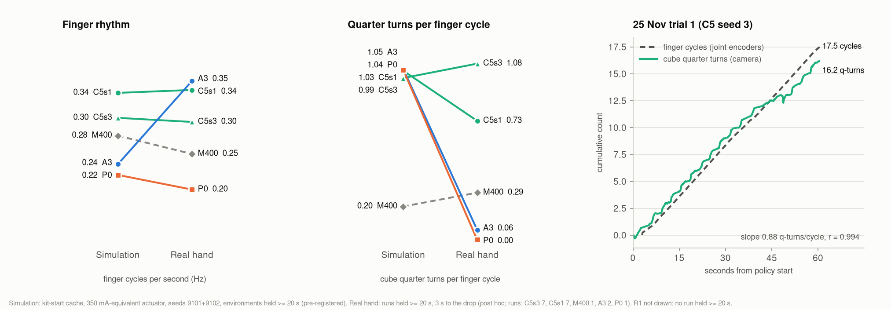

# Gait efficiency: where did the speed go on the real hand?

**Question.** While the cube is held, rotation speed factorises exactly:

> quarter turns per second = finger cycles per second × quarter turns per finger cycle.

The joint encoders give the finger cycles with no cube sensor, and dividing rotation by cycles gives turns per cycle. Measuring both factors for the same policies in simulation and on the real hand shows which one broke in transfer.

**Status.**
- **Real-hand half: exploratory and post hoc.** It was computed on logs already in git, before the plan below existed.
- **Simulation half: pre-registered.** `ANALYSIS_PLAN.md` was hashed before any rollout (`logs/analysis_plan.sha256`, 2026-11-27 00:09 +04), and the hash still matched after the rollouts.
- Evaluation only: no training, no hardware.

## Answer



**Where the speed went (`results/decomposition.md`):**

| Policy | Real runs | Rhythm Hz, sim → real (ratio) | Quarter turns / cycle, sim → real (ratio) | Speed while held, sim → real (ratio) | Verdict (plan rules) |
|---|---|---|---|---|---|
| C5 seed 3 | 7 | 0.30 → 0.30 (0.981) | 0.99 → 1.08 (1.089) | 0.297 → 0.302 q-turns/s (1.017) | both factors transferred; speed transferred |
| C5 seed 1 | 7 | 0.34 → 0.34 (1.012) | 1.03 → 0.73 (0.703) | 0.334 → 0.249 (0.746) | rhythm transferred, turns per cycle did not; the turns-per-cycle factor accounts for all of the speed change (120%; rhythm −20%) |
| A3 | 2 | 0.24 → 0.35 (1.476) | 1.05 → 0.06 (0.058) | 0.245 → 0.026 (0.107) | the fingers cycled *faster* on the hand, but each cycle turned the cube about 1/17 as far |
| model_400 | 1 | 0.28 → 0.25 (0.910) | 0.20 → 0.29 (1.414) | 0.058 → 0.091 (1.580) | one run, 2 quarter turns: not interpretable |
| P0 | 1 | 0.22 → 0.20 (0.911) | 1.04 → 0.00 | 0.230 → 0 | no rotation on the hand; its real motion while held is small (0.53 rad stroke vs 1.72 in simulation) |
| R1 | 0 | 0.21 → – | 0.93 → – | 0.194 → – | no run held ≥ 20 s; no comparison |

- **Simulation:** kit-start cache, 350 mA-equivalent actuator, seeds 9101 + 9102, environments held ≥ 20 s (`results/sim.json`).
- **Real hand:** window 3 s to the operator's drop time, runs held ≥ 20 s (`results/real_hand.json`, variant `held`).

**In words.**
- **The finger rhythm transferred** for both C5 seeds and model_400. A3 cycled faster on the hand. P0's FFT rhythm and cycle rate disagree, so it gets no label.
- **The speed was lost in turns per cycle.** Where speed was lost (C5 seed 1, A3, P0), the fingers kept moving in real strokes, but each stroke turned the cube less, or not at all:
  - real median stroke 1.73 rad for C5 seed 1 (1.47× its simulated size) and 1.03 rad for A3 (0.80×);
  - the exception is P0, at 0.53 rad (0.31×).
- **C5 seed 3** is the one policy where both factors, and so its speed while held, transferred within ±25%.
- **What the logs cannot tell apart:** slip, missed contact and back-and-forth rocking all look the same in joint data.

**Counter check (C5 seed 3 only).** On 25 Nov, cumulative finger cycles track the camera's cumulative quarter turns: slope 0.88 quarter turns per cycle, r = 0.994 (trial 1); 0.88, r = 0.993 (trial 5, to the drop). Trial 4 dropped at 5 s and has too little data. The cycle count is **not** validated as a turn counter for any other policy.

## Real-hand half (exploratory, post hoc)

`scripts/real_hand.py` → `results/real_hand.{json,md}`:
- **Data:** 20/24/25 Nov run logs (`q_hw` at 20 Hz) and the operator's quarter-turn counts.
- **Inclusion:** no intervention, count present.
- **Two windows:**
  - `run`: 3 s to the end of the run, runs ≥ 20 s. This is the instruction's procedure.
  - `held`: 3 s to the drop, held ≥ 20 s. Same rule as simulation.
- **First pass, reproduced:** the `run` window reproduces the earlier first pass: 0.87 / 0.69 / 0.19 / 0.14 / 0.07 / 0.00 quarter turns per cycle for C5s3 / C5s1 / M400 / R1 / A3 / P0.
- **Differences to the first pass** (explained in `real_hand.md`):
  - Rhythm differs by ≤ 0.02 Hz: that pass used a plain FFT, this one a windowed one.
  - The trial-5 camera slope differs (0.79 there vs 0.88 here), because that pass counted past the 30-s drop.
- **Robustness of the policy ranking:**
  - It holds with each finger's joints alone, with the 0.1–1.5 Hz band, and with runs ≥ 10 s.
  - With per-run medians, A3 and R1 swap places.
- **The window matters for droppers.** After a drop the fingers keep cycling with no cube, so the `run` window lowers turns per cycle for policies that drop early. C5 seed 3: 0.87 with the `run` window, 1.08 with `held`. R1's low `run` value is mostly this effect.

## Limits

- **Small samples:** in the comparison window A3 has 2 runs, model_400 and P0 one each, R1 none.
- **Operator counts** are by eye.
- **Camera checks** exist only for C5 seed 3.
- **No statistical test** of sim vs real is made.
- **Simulation CIs** (`sim.json`) are over environments and describe simulation variation only.
- **The ±25% band** is justified in `ANALYSIS_PLAN.md` §7.5. A ratio inside it cannot be told apart from "unchanged" with these data.
- **The simulated actuator** responds about 3.5× more slowly than the hand (c5_hw_v2 §3). A matching rhythm therefore does not mean matching joint dynamics.

## Files

- `ANALYSIS_PLAN.md`; `logs/analysis_plan.sha256`, `logs/analysis_plan_hashed_at.txt`, `logs/real_hand_at_plan.sha256`.
- Scripts (`scripts/`):
  - `gait.py`: the shared cycle counter;
  - `real_hand.py`;
  - `sim_gait.py`: items, Slurm worker, analysis; reuses `c5_hw_v1` `rollout` and `c5_hw_v2` setting K unchanged;
  - `decompose.py`;
  - `figure.py`: README figure style.
- Results (`results/`): `real_hand.{json,md}`, `sim.json`, `items/*.json`, `decomposition.{json,md}`.
- Figures: `figures/gait_efficiency.png`, `figures/gait_efficiency_dark.png`.
- Raw rollouts: `data/*.npz`, 32 files, git-ignored.
- Tests: `training_source/project/tests/test_gait_efficiency.py`.

## Reproduction (from `training_source/project`, conda env `leap-estimator`)

```bash
python experiments/gait_efficiency/scripts/real_hand.py
python experiments/gait_efficiency/scripts/sim_gait.py --make-items
CMD="experiments/gait_efficiency/scripts/sim_gait.py --items experiments/gait_efficiency/items/sim_items.json" \
  sbatch --job-name=gait --output=experiments/gait_efficiency/logs/slurm_%j.out experiments/c5_hw_v2/scripts/sbatch_job.sh   # x2 workers
python experiments/gait_efficiency/scripts/sim_gait.py --analyse
python experiments/gait_efficiency/scripts/decompose.py
uv run --no-project --with matplotlib --with numpy --with scipy python experiments/gait_efficiency/scripts/figure.py
```

32 rollouts of 256 environments × 60 s took 85–150 s each on ws-ia GPUs (jobs 332510 and 332511).
