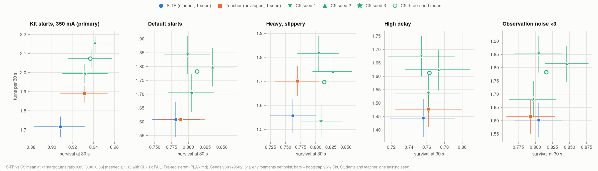

# PT-student: does a privileged teacher distilled into a transformer student beat C5?

**Idea.** Yao et al. (arXiv 2605.21330, v1, May 2026; preprint) report their largest real-hand gain from one recipe:
- a PPO teacher that sees the true cube state;
- distilled into a small transformer student that sees only joint history;
- with an auxiliary loss that makes the student also predict the cube state.

This study asks whether that recipe beats C5 in our simulation and, if so, which part is responsible. Section 0 of `PLAN.md` records what the paper reports and where this study differs from it.

**Status.**
- Everything below follows `PLAN.md`. It was hashed before any training: sha256 `e8b61b90…` in `logs/plan.sha256`, 2026-11-27 19:47 +04.
- **Simulation only.** No policy was deployed, and none was copied into the kit.
- **One training seed for everything trained here** (teacher, students, variant: seed 1). The C5 rows are C5's three training seeds.
- Step 3 and the Step 4 controls are pre-registered. Step 5 is exploratory.

## Result (Step 3, pre-registered): S-TF fails all three criteria



**Setup.**
- **Policies:**
  - S-TF;
  - the privileged teacher T;
  - C5 seeds 1–3 from `grasp_rotation_v2/deploy/policies/` (hashes checked).
- **Rollouts:** 512 environments × 60 s per policy and condition (evaluation seeds 9501 + 9502), on the existing harness unchanged (`c5_hw_v1` rollout under `c5_hw_v2` setup).
- **Bars:** bootstrap 95% CIs over environments.

Turns per 30 s / survival at 30 s / survival at 60 s (`results/sim.md`):

| Policy | K: kit starts, 350 mA (primary) | A: default | Heavy, slippery | High delay | Obs. noise ×3 |
|---|---|---|---|---|---|
| **S-TF** (student, 1 seed) | **1.72** / **0.908** / 0.887 | 1.61 / 0.781 / 0.699 | 1.56 / 0.762 / 0.691 | 1.44 / 0.756 / 0.668 | 1.60 / 0.805 / 0.758 |
| T (privileged teacher, 1 seed) | 1.89 / 0.932 / 0.924 | 1.61 / 0.789 / 0.723 | 1.70 / 0.770 / 0.697 | 1.48 / 0.762 / 0.693 | 1.62 / 0.793 / 0.727 |
| C5 seed 1 | 2.15 / 0.941 / 0.939 | 1.84 / 0.799 / 0.787 | 1.82 / 0.805 / 0.801 | 1.68 / 0.754 / 0.744 | 1.85 / 0.805 / 0.797 |
| C5 seed 2 | 2.07 / 0.938 / 0.936 | 1.80 / 0.836 / 0.822 | 1.74 / 0.828 / 0.818 | 1.63 / 0.773 / 0.768 | 1.82 / 0.846 / 0.834 |
| C5 seed 3 | 2.00 / 0.932 / 0.932 | 1.71 / 0.805 / 0.795 | 1.53 / 0.809 / 0.801 | 1.54 / 0.762 / 0.754 | 1.68 / 0.797 / 0.793 |
| **C5 mean** | **2.07** / **0.937** / 0.936 | 1.78 / 0.813 / 0.801 | 1.70 / 0.814 / 0.807 | 1.61 / 0.763 / 0.755 | 1.78 / 0.816 / 0.808 |

| Pre-registered criterion (S-TF vs the C5 mean, setting K) | Needed | S-TF | |
|---|---|---|---|
| 1. Turns per 30 s, ratio to C5 [95% CI] | ≥ 1.15, CI above 1 | **0.828 [0.801, 0.855]** | ✗ |
| 2. Survival at 30 s | ≥ 0.927 (C5 − 0.01) | **0.908** | ✗ |
| 3. Stress survival at 60 s (mean of 3 presets) | ≥ 0.770 (C5 − 0.02) | **0.706** | ✗ |

**FAIL.**
- **Beats every C5 seed?** No. The turns ratio is 0.80 [0.77, 0.83] to seed 1, 0.83 [0.80, 0.86] to seed 2 and 0.86 [0.83, 0.89] to seed 3. S-TF is below each seed.
- **Expectation:** the plan expected S-TF to land at 0.9–1.15 × C5. It landed below that.
- **Step 6 (hand-test preparation) was not done.** The plan allows it only if S-TF passes.

**Why: the teacher was not better than C5, and the student lost more.**
- **The privileged teacher is below C5.** It turns 0.911 [0.888, 0.934] × C5 at K, below every seed, and its stress survival is 0.706. The plan expected the teacher to be clearly above C5; it is not.
- **The training logs say the same.** In the same environment and reward, the teacher averaged reward 2.66 and genuine yaw rate 0.327 over updates 2800–3000, against 2.87–2.96 and 0.341–0.360 for the C5 seeds (`results/training.md`). Seeing the cube's pose, velocities, mass, friction and centre of mass did not make PPO learn a faster gait within C5's 3001 updates. The paper's teacher ran 10,000 iterations with a 4-layer MLP (`PLAN.md` §0); this study kept C5's network and budget, as instructed.
- **Distillation cost another 9%.** S-TF turns 1.72 against the teacher's 1.89 at K, and survives less at 30 s (0.908 against 0.932).
- **Both copy a jamming gait.** At K the jam proxy (an index-finger jam of ≥ 1 s within 60 s) is 0.71 for T and 0.80 for S-TF, against 0.02–0.10 for the C5 seeds. The teacher leans on the index MCP: it is saturated in 15.5% of steps, against 3.3% for C5 seed 3 (first 30 s, evaluation seed 9501; `sat_if_mcp` in `results/items/K_T_s9501.json` and `K_C5s3_s9501.json`).
- **S-TF commands more smoothly.** Its mean |Δcommand| is 0.0166 rad/step, against 0.026 for C5. Its rhythm (0.308 Hz) and quarter turns per cycle (0.946) are close to C5's (0.322, 1.015).

## Controls (Step 4, pre-registered, descriptive): which part matters?

Same teacher, data budget and schedule as S-TF:
- **S-TF-noaux** sets the auxiliary weights to 0.
- **S-MLP** is C5's actor architecture (320 → 512-512-256 ELU) with the same heads and loss.

| At K | Turns ratio to C5 [95% CI] | Survival 30 s | Stress survival 60 s | Jam proxy | Action loss (last 100 updates) |
|---|---|---|---|---|---|
| S-TF | 0.828 [0.801, 0.855] | 0.908 | 0.706 | 0.80 | 0.267 |
| S-MLP | 0.815 [0.785, 0.846] | 0.879 | 0.743 | 0.69 | 0.371 |
| S-TF-noaux | *pending (job 339962)* | | | | |

**Transformer vs MLP.** The transformer fits the teacher better: action loss 0.267 against 0.371, and cube position and orientation losses about half of S-MLP's.
- **Turns:** S-MLP turns at nearly the same rate as S-TF (0.815 against 0.828; the CIs overlap).
- **Survival at K:** S-MLP survives less (0.879).
- **Stress:** S-MLP holds the cube better (0.743).

The architecture changes how closely the student copies the teacher, not how fast it turns. One training seed each, so differences of this size are not resolved.

## Step 5 (exploratory): does S-TF's orientation head follow the real cube?

- **Gate passed.** All 27 real C5 seed 1 / seed 3 runs were replayed with the kit's own code, and the logged policy reproduces its raw actions to 5.7e-6 (gate 1e-4).
- **Method:** S-TF's orientation head gives yaw modulo 90°, which was unwrapped and compared with the camera from the policy start to the drop (`results/real_log.md`).
- **Caveat:** C5 drove these runs, not the student.

| 25 Nov trial | Window | Camera quarter turns | Operator | S-TF quarter turns (rate r) | Estimator B quarter turns (rate r) |
|---|---|---|---|---|---|
| 1 | 0–60 s | 16.2 | 16 | 12.0 (0.47) | 4.7 (0.13) |
| 4 | 0–5 s | 0.7 | 2 | 2.0 (0.08) | 0.3 (0.51) |
| 5 | 0–30 s | 6.9 | 8 | 7.5 (0.43) | 3.9 (0.18) |

- **Camera trials:** in the two longer trials, S-TF's yaw count lands nearer the camera's (12.0 against 16.2; 7.5 against 6.9) than estimator B's does (4.7, 3.9). Its rate follows the camera moderately (r 0.47 and 0.43).
- **Ranking runs** (extra, not in the plan): across the 15 runs held at least 10 s, S-TF does not rank runs by quarter turns per held minute (Spearman −0.04; estimator B −0.39).
- **Bottom line:** some within-trial signal, no between-run signal, three trials.

## Optional action-rate variant (PLAN 4.3)

A teacher with one added reward term, the paper's action-rate penalty:
- the term is weight −0.075 × Σ (tanh u_t − tanh u_{t−1})²;
- task `Mjlab-Leap-PT-Teacher-AR`; everything else as the teacher;
- then an S-TF distilled from it (S-TF-AR), with the same evaluation.

*Pending: teacher job 339968.*

## Deviations and run notes

- **First teacher run killed externally.** Job 338614 ended at about update 990 of 3001 with no error and no exit line (`logs/interruptions.txt`). It was retrained from scratch as job 339167, never resumed. The interrupted run is kept as `*_INTERRUPTED` and not used.
- **Bootstrap streams.**
  - **Before:** the plan fixes rng 20261130, and the first analysis drew all cells from one shared stream. Adding a policy therefore shifted the other policies' CIs in the third decimal.
  - **The change:** after the S-TF result, each (cell, purpose) got its own stream seeded from 20261130, so the controls cannot move the main CIs.
  - **Effect:** no verdict changed. For example, the teacher's turns CI was [0.888, 0.935] in commit 842708a and is [0.888, 0.934] now.
- **The criteria rows for T and the controls** in `results/sim.md` apply S-TF's bars for reference only. Only S-TF's criteria are pre-registered.
- **Step 5 extra measure:** the between-run Spearman is not in the plan. It uses rates (quarter turns per held minute) because total counts mostly measure how long the cube was held, whatever the predictor.
- **The variant was not started last.** Job 339968 was submitted at 09:17 on 28 Nov, after the main result but while the controls were still training. The plan says "only if everything else is done". It waited in the queue until S-MLP finished and did not delay the main result or the controls.
- **The session restarted once (09:12).** It cleared temporary job-watcher scripts. No job was affected.

## GPU hours

From the job logs (`results/training.md`, `scripts/training_summary.py`). One RTX 5000 Ada per job; short smoke tests are not counted.

| Job | Hours |
|---|---|
| Teacher, killed externally (338614, not used) | 2.22 |
| Teacher (339167) | 4.19 |
| S-TF (339499) | 5.84 |
| S-MLP (339963) | 2.05 |
| S-TF-noaux (339962) | *pending* |
| Action-rate teacher (339968) and S-TF-AR | *pending* |
| Evaluation (sum over items) | 1.89 so far |

## Files

| Path | What |
|---|---|
| `PLAN.md`, `logs/plan.sha256` | pre-registered plan and its hash |
| `src/…/leap_right_pt_student/` | teacher tasks `Mjlab-Leap-PT-Teacher` (C5's environment; actor sees actor + critic groups, 403-D) and `-AR` |
| `scripts/models.py` | S-TF (3 layers, 4 heads, width 256, FF 1024, learned positional embedding, CLS → 16 actions + aux heads; 2.39 M parameters), S-MLP |
| `scripts/distill.py`, `scripts/sbatch_distill.sh` | DAgger (β 1 → 0 over the first 300 of 1500 updates) |
| `scripts/sbatch_train_teacher{,_ar}.sh` | teacher training (3001 updates, 4096 environments, seed 1) |
| `scripts/eval_items.py`, `items/*.json` | evaluation items and analysis → `results/sim.{json,md}` |
| `scripts/real_log.py` | Step 5 → `results/real_log.{json,md}` |
| `scripts/training_summary.py` | training curves, losses, GPU hours → `results/training.{json,md}` |
| `scripts/figure.py` | `figures/sim{,_dark}.png` |
| `tests/test_pt_student.py` (project) | token layout, shapes, save/load, targets; the teacher tasks differ from C5 only where stated |

Checkpoints (`runs/`, `logs/rsl_rl/pt_student_teacher*`) and rollout arrays (`data/`) are git-ignored. Their sha256 hashes are in the item files and distillation logs.

**Reproduce** (from `training_source/project`):

```bash
sbatch experiments/pt_student/scripts/sbatch_train_teacher.sh
STUDENT=S-TF sbatch experiments/pt_student/scripts/sbatch_distill.sh        # also S-TF-noaux, S-MLP
python experiments/pt_student/scripts/eval_items.py --items experiments/pt_student/items/main.json   # any number of workers
python experiments/pt_student/scripts/eval_items.py --analyse
python experiments/pt_student/scripts/real_log.py
python experiments/pt_student/scripts/training_summary.py
```
