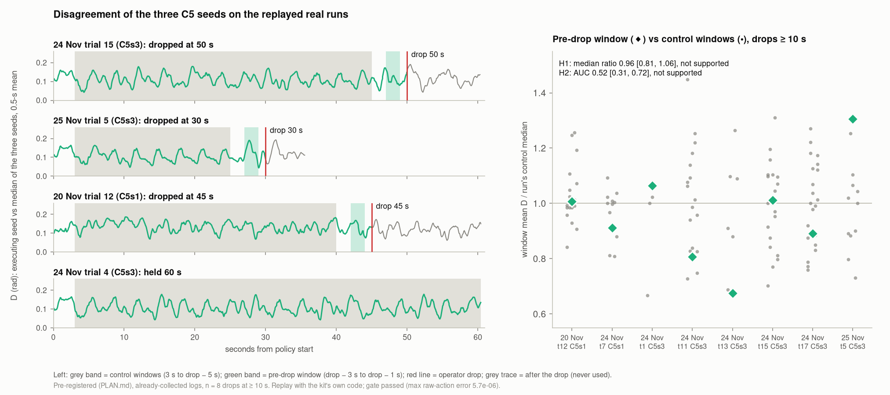
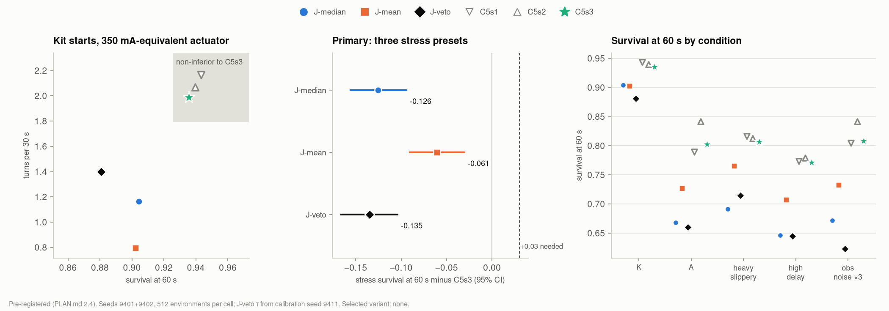

# Seed jury: do the three C5 seeds disagree before a drop, and does a jury of them hold the cube better?

**Idea.** C5 was trained with three seeds of one recipe:

| Seed | Kit name | sha256 |
|---|---|---|
| seed 1 | `C5` | `2a932dfe…` |
| seed 2 | `C5s2` | `49579bdf…` |
| seed 3 | `C5s3` | `c221af89…` |

The hypothesis has two parts:
- The real-hand drops (a finger moves suddenly and pushes the cube out) happen in states that training never showed, and there the seeds disagree.
- A jury that executes the seeds' joint choice instead of one seed's would then outvote the rogue moves.

**Status.**
- Everything below follows `PLAN.md`, which was hashed before any disagreement value was computed: sha256 `978d52e7…` in `logs/plan.sha256`, 2026-11-27 18:45 +04.
- Step 1 replays logs that already existed, n = 8 drops at ≥ 10 s.
- Step 2 is simulation only. No training, no hardware.

## Step 1: real-hand replay (pre-registered, already-collected logs, small n)



**Gate: passed.**
- **What was replayed:** all 27 real C5 seed 1 / seed 3 runs (18,515 steps), with the kit's own `policy_runtime.LeapPolicy` and `deploy_direct` joint maps and limits.
- **Raw actions:** the seed that ran reproduces the logged raw action to **5.7e-6** at every step (tolerance 1e-4).
- **Executed commands:** reproduced to 1.5e-7 rad (`results/real_replay.md`).

**Disagreement D** = ‖executing seed's command − per-joint median of the three seeds' commands‖ (rad), smoothed over 0.5 s.

**H1 and H2: not supported.** In the pre-registered window (3 s to 1 s before the operator's drop), the seeds did **not** disagree more than during the same run's earlier holding:

| Test | Result |
|---|---|
| H1: pre-drop D / run's control median | median ratio **0.96 [0.81, 1.06]**; 4 of 8 runs above 1 |
| H2: AUC, pre-drop vs control windows | **0.52 [0.31, 0.72]** |

**Other results.**
- **Sensitivity window (2 s to 0.5 s before the drop):** all 8 ratios fall *below* 1, median 0.91 [0.79, 0.95]; AUC 0.35 [0.19, 0.47]. If anything, the seeds agree slightly more just before a drop. That direction was not a pre-registered hypothesis, so it is exploratory.
- **Disagreement is high all the time.** D̄ ≈ 0.10–0.15 rad throughout, and it oscillates with the finger cycle (figure, left). The seeds have different gaits (`gait_efficiency`: 0.34 vs 0.30 Hz), so "disagreement" mostly measures gait phase, not surprise.
- **Per finger:** no finger's ratio has a CI that excludes 1. The thumb is highest: 1.34 [0.87, 2.54].
- **Early drops (< 10 s, 12 runs):**
  - Against the same seconds of the same seed's held runs, the median ratio is 1.02.
  - The largest single-finger disagreement in their window exceeds the p99 of later control windows in 8 of 12. But the held runs are just as high in their first seconds, so this is the start-up transient, not a drop signal.
- **The "sudden move":** the executed per-finger step is at the action bound (all 4 joints at 1/24 rad per step) in all 8 primary pre-drop windows. The control windows reach that bound too: their 99th percentile sits at it. The policy often moves at full speed, so a single fast step does not mark a drop.
  - Only two early C5 seed 1 drops exceed their control p99: 24 Nov t3, ring, operator note "dropped because of limit"; t6, index, "limit hit".
  - **Deviation from the plan:** ties at the bound are not counted as exceedances (a 1e-4 rad tolerance), because the plan did not say how to handle ties. See `results/real_replay.md`.
- **Camera check (25 Nov trial 5):** the camera's rotation stopped at 25.0 s against the operator's 30 s. With the camera time the run's ratio falls from 1.31 to 0.90, and the H1 median becomes 0.91.

**What this means for the idea.** On the logged real runs, the three seeds do not disagree unusually just before a drop. The premise of the jury (rogue moves happen where the seeds disagree) is not supported by these data. Step 2 tests the jury anyway, as pre-registered.

## Step 2: jury in simulation (pre-registered)



**Setup.**
- Each jury is one policy: the same 320-D observation, the three seeds' actors (each with its own normaliser), one 16-D action. The executed jury command feeds back into the observation.
- **Rollouts:** 512 environments × 60 s per policy and condition (seeds 9401 + 9402), on the existing harness unchanged.
- **J-veto's τ:** the 95th percentile of C5s3's per-joint deviation from the median, on calibration seed 9411 (`results/tau.json`). For 5 of 16 joints τ equals the largest possible deviation (2/24 rad), so the veto almost never acts on them. It acts mainly on the thumb: th_mcp τ = 0.038 rad.

**Run notes.**
- The first submission (jobs 338470/338471) crashed on its first item, before any rollout finished. The cause was a bug in the recording wrapper.
- After the fix (388e7cc), all 61 items ran on jobs 338486/338487 plus two workers on the interactive node's two GPUs. The workers shared the item list through claim files.
- Items, seeds and analysis are as in the plan.

**Result: no variant passes; none is selected; Step 3 is not done** (`results/sim.md`):

| Variant | Kit starts: survival at 60 s / turns per 30 s | Non-inferior? | Stress survival at 60 s, minus C5s3 [95% CI] | Kit-start jam proxy vs C5s3 |
|---|---|---|---|---|
| C5s3 (reference) | 0.936 / 1.99 | – | (0.796) | 0.0273 |
| J-median | 0.904 / 1.16 | no | −0.126 [−0.156, −0.094] | −14% (CI of difference includes 0) |
| J-mean | 0.902 / 0.79 | no | −0.061 [−0.090, −0.031] | +107% |
| J-veto | 0.881 / 1.40 | no | −0.135 [−0.166, −0.104] | +379% |

**Why the juries fail.** Every jury is worse than every single seed in every condition, for survival and for turns. The seeds are three different gaits, so combining them per joint breaks each gait:

| Policy | Rhythm (Hz) | Quarter turns per cycle | Mean \|Δcommand\| (rad/step) |
|---|---|---|---|
| single seeds | 0.30–0.34 | 0.99–1.04 | 0.025–0.028 |
| J-median | 0.24 | 0.71 | – |
| J-mean | 0.18 | 0.59 | 0.012 |
| J-veto | 0.28 | 0.81 | – |

- **J-mean** cancels motion: averaging opposing moves halves the command change.
- **J-median** keeps full-speed moves, but per joint they come from different seeds, so they no longer form one coordinated stroke.

**Real vs simulated disagreement (descriptive).**
- With C5s3 executing, the seeds disagree *less* on the real hand: real median D̄ 0.101 rad (control windows), simulated 0.149 rad (kit starts). Real/simulation ratio: median 0.68, 95th percentile 0.90.
- So the real states are not more "surprising" to the jury than simulated ones. This matches Step 1.

**Conclusion.**
- The premise was not supported on the real logs (Step 1), and the jury lost to C5s3 alone in every pre-registered comparison (Step 2).
- A per-joint jury of independently trained seeds is not a fix for the real-hand drops.
- Exploratory and outside the plan: if seed diversity is to help, it would need seeds that share a gait (e.g. distillation into one student), not voting among different gaits.

## Files

- `PLAN.md`; `logs/plan.sha256`, `logs/plan_hashed_at.txt`.
- **Scripts** (`scripts/`):
  - `real_replay.py`: Step 1;
  - `figure_real.py`;
  - `sim_jury.py`: Step 2 items, worker and analysis; reuses `c5_hw_v1` `rollout` / `summarise` and `c5_hw_v2` setting K unchanged;
  - `figure_sim.py`.
- **Results** (`results/`): `real_replay.{json,md}`, `tau.json`, `items/*.json`, `sim.{json,md}`.
- **Figures** (`figures/`): `real_replay{,_dark}.png`, `sim{,_dark}.png`.
- **Not in git:** the raw rollouts, `data/*.npz`.
- **Tests:** `training_source/project/tests/test_seed_jury.py` (CPU).

## Reproduction

```bash
python training_source/project/experiments/seed_jury/scripts/real_replay.py           # numpy only, ~10 s
uv run --no-project --with matplotlib --with numpy python training_source/project/experiments/seed_jury/scripts/figure_real.py
cd training_source/project
python experiments/seed_jury/scripts/sim_jury.py --make-items
CMD="experiments/seed_jury/scripts/sim_jury.py --items experiments/seed_jury/items/sim_items.json" \
  sbatch --job-name=jury --output=experiments/seed_jury/logs/slurm_%j.out experiments/c5_hw_v2/scripts/sbatch_job.sh   # x2
python experiments/seed_jury/scripts/sim_jury.py --analyse
```
